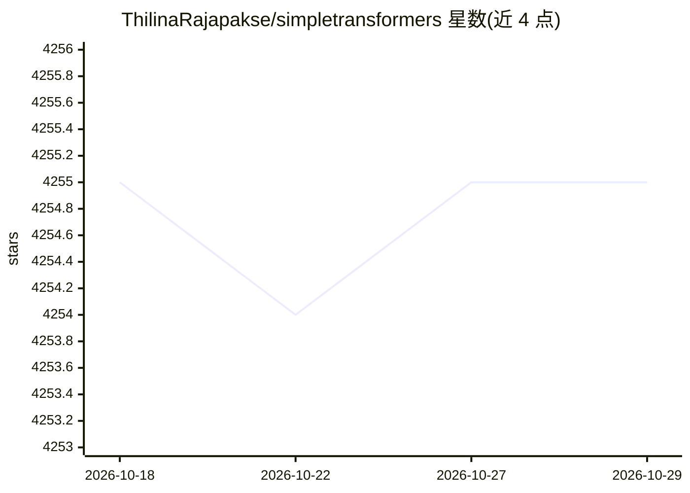

# ThilinaRajapakse/simpletransformers

⭐ 4,255 · Python · Apache-2.0 · 推送 2026-05-31 · [GitHub](https://github.com/ThilinaRajapakse/simpletransformers) · [官网](https://simpletransformers.ai/) · 个人维护

**简化 Transformer 模型训练评估的 Python 库，3 行代码完成训练**

基于 HuggingFace Transformers 库封装的上层框架：针对文本分类、NER、问答、语言生成、T5、多模态分类、对话 AI、稠密检索等十余种 NLP 任务，各提供专用模型类（如 ClassificationModel、NERModel、RetrievalModel），遵循初始化、train_model() 训练、eval_model() 评估、predict() 预测的统一流程。通过 conda 环境 + pip 安装，支持 CUDA 与 CPU 两种 PyTorch 安装路径，可选集成 Weights and Biases 做实验跟踪。附论文引用信息与大量贡献者列表。

## 筛选速览

| 维度 | 判定 | 备注 |
|---|---|---|
| AI 角色 | `ai-native` | 本体是模型或模型工具 |
| 许可风险 | `permissive` | Apache-2.0 |
| 部署形态 | `library` | 以包/库形式分发 |
| 模型依赖 | — | README 未给出锁定关系 |
| 硬件要求 | — | 无带数字的原话,不猜 |
| 安装摩擦 | `medium` | 含编译或系统依赖之一 |
| 成熟度 | — | 结构信号不足 |

## 能力要点

- 十余种 NLP 任务各有专用模型类，统一 init/train/eval/predict 流程
- 支持稠密检索、语言生成、T5、多模态分类、对话 AI 等任务
- 兼容 Hugging Face 上各 model_type 的预训练模型
- 可选 wandb 实验跟踪，附 Colab 示例

## 适用场景

- 用少量代码快速微调与评估 Transformer 分类/NER/问答模型
- 训练对话 AI 或语言生成模型
- 基于预训练模型做文本表示生成与文档检索

## 场景标签

`微调` · 领域:训练与推理

## 证据(README 行号)

> L7: This library is based on the Transformers library by HuggingFace. `Simple Transformers` lets you quickly train and e
> L89: |Task|Model|

## 星数曲线

2026-10-18 4,255 → 2026-10-29 4,255（+0）

---
*卡片 v1 · prompt 1.4 · 生成 2026-10-21 · 置信度 high · 依据 README sha `07675033deef` · [字段定义](../../DATASET.md)*
