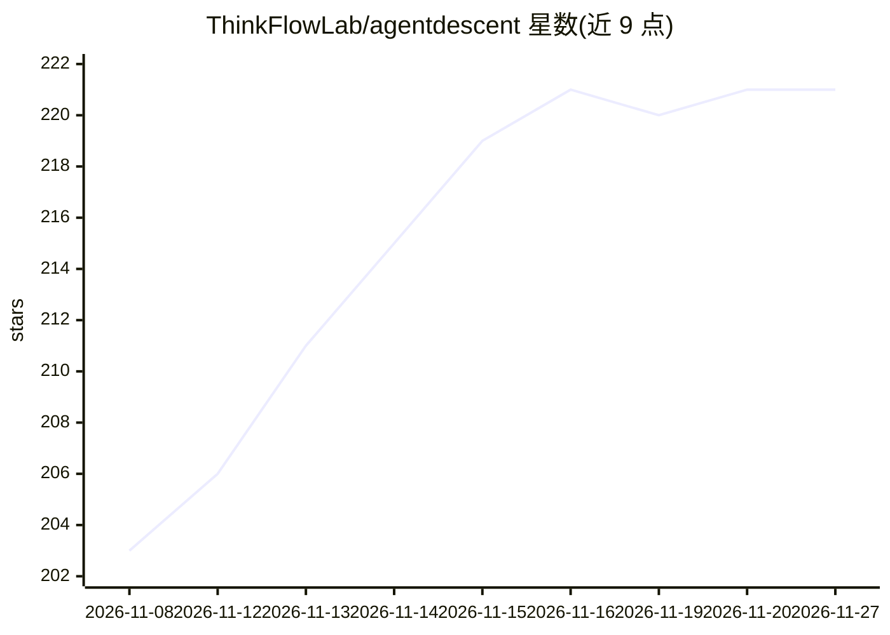

# ThinkFlowLab/agentdescent

⭐ 221 · Python · MIT · 推送 2026-11-26 · [GitHub](https://github.com/ThinkFlowLab/agentdescent) · [官网](https://thinkflowlab.github.io/agentdescent/) · 组织维护

**并行异步自进化 agent 框架：演化提示、技能与代码**

将提示词、技能库、agent 目录、agent 代码与宿主插件作为被优化对象：N 个 worker 并行异步地对自身示例提出 diff 编辑，单一聚合器经五阶段合并流水线写入 git 账本，留出集门控决定保留项。可从 Python 的 evolve() 调用、CLI 或 Claude Code/Codex/OpenCode 等宿主使用。README 自述为研究参考实现而非生产系统，并注明吞吐前提是有待检验的假设；离线 demo 与测试无需 API key；[mcp] 需 Python ≥3.10，库本身支持 3.9。

## 筛选速览

| 维度 | 判定 | 备注 |
|---|---|---|
| AI 角色 | `ai-ecosystem` | LLM/agent 周边工具 |
| 许可风险 | `permissive` | MIT |
| 部署形态 | `library` | 以包/库形式分发 |
| 模型依赖 | — | README 未给出锁定关系 |
| 硬件要求 | — | 无带数字的原话,不猜 |
| 安装摩擦 | `low` | 无编译、无系统依赖或容器化 |
| 成熟度 | `idea` | |

## 能力要点

- N worker 并行提出 diff、单一聚合器合并、留出集门控保留
- 多文件技能库演化（skill_library），非单一 prompt
- Python evolve()、CLI 与 Claude Code 等宿主三种使用方式
- 离线确定性 demo 与 pytest，无需 API key

## 适用场景

- 用自有数据集演化技能库或提示词
- 从 Claude Code 等宿主内运行演化循环
- 复现或注册演化算法端口做研究实验

## 场景标签

`Agent 框架` `提示工程` · 领域:Agent 开发

## 证据(README 行号)

> L7: > **Gradient descent — but the parameters are agents.** AgentDescent evolves
> L11: > kept. Use it from Python with one `evolve()` call, from the CLI, or from inside
> L119: A **research reference implementation**, not a production system. The novelty is

## 星数曲线

2026-11-08 203 → 2026-11-27 221（+18）

---
*卡片 v1 · prompt 1.4 · 生成 2026-11-27 · 置信度 high · 依据 README sha `63a17745c309` · [字段定义](../../DATASET.md)*
