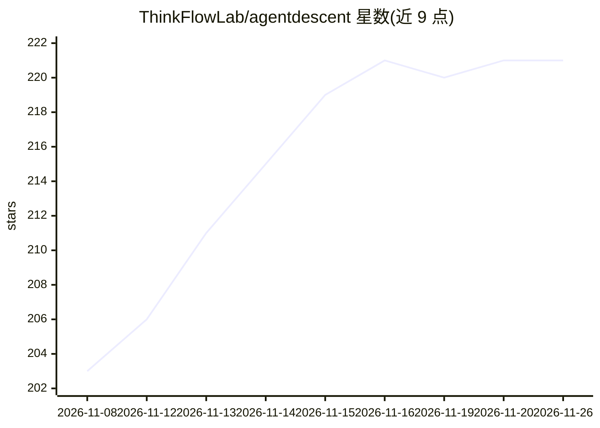

# ThinkFlowLab/agentdescent

⭐ 221 · Python · MIT · 推送 2026-11-25 · [GitHub](https://github.com/ThinkFlowLab/agentdescent) · [官网](https://thinkflowlab.github.io/agentdescent/) · 个人维护

**面向开发者的 agent 自进化框架：并行提议 diff、聚合器合并进化 agent**

AgentDescent 是一个并行异步框架，将梯度下降类比用于 agent 参数：N 个 worker 对提示词、多文件技能库、agent 目录、agent 代码和 host 插件并行提出修改 diff，单个聚合器经五阶段合并管线合入 git 版本化账本，由 held-out 门控决定保留项。可通过 Python 的 evolve() 调用、CLI 或从 Claude Code、Codex、OpenCode 等 host 内使用。README 自述为研究参考实现而非生产系统，pytest 离线且无需 API key。

## 筛选速览

| 维度 | 判定 | 备注 |
|---|---|---|
| AI 角色 | `ai-ecosystem` | LLM/agent 周边工具 |
| 许可风险 | `permissive` | MIT |
| 部署形态 | `library` | 以包/库形式分发 |
| 模型依赖 | — | README 未给出锁定关系 |
| 硬件要求 | — | 无带数字的原话,不猜 |
| 安装摩擦 | `low` | 无编译、无系统依赖或容器化 |
| 成熟度 | — | 结构信号不足 |

## 能力要点

- diff 即梯度、聚合器即优化器的自进化机制，N worker 并行 + held-out 门控
- 支持进化提示词、技能库、agent 目录、agent 代码与 host 插件
- 提供离线 demo（agentdescent demo，无需 API key）与 doctor/plan/start/apply 流程
- 23 个命名算法端口，用例数据置于 bench/results/ 与 CITATION.cff

## 适用场景

- 用自有样例数据集进化 agent 的提示词与技能规则
- 在 Claude Code 等 host 内通过 MCP 调用进化工具
- 研究并行 diff 合并与 agent 自进化算法

## 场景标签

`Agent 框架` `提示工程` `编码 Agent` · 领域:Agent 开发

## 证据(README 行号)

> L7: > **Gradient descent — but the parameters are agents.** AgentDescent evolves
> L11: > kept. Use it from Python with one `evolve()` call, from the CLI, or from inside
> L119: A **research reference implementation**, not a production system. The novelty is

## 星数曲线

2026-11-08 203 → 2026-11-26 221（+18）

---
*卡片 v1 · prompt 1.4 · 生成 2026-11-25 · 置信度 high · 依据 README sha `45927ed91ce8` · [字段定义](../../DATASET.md)*
