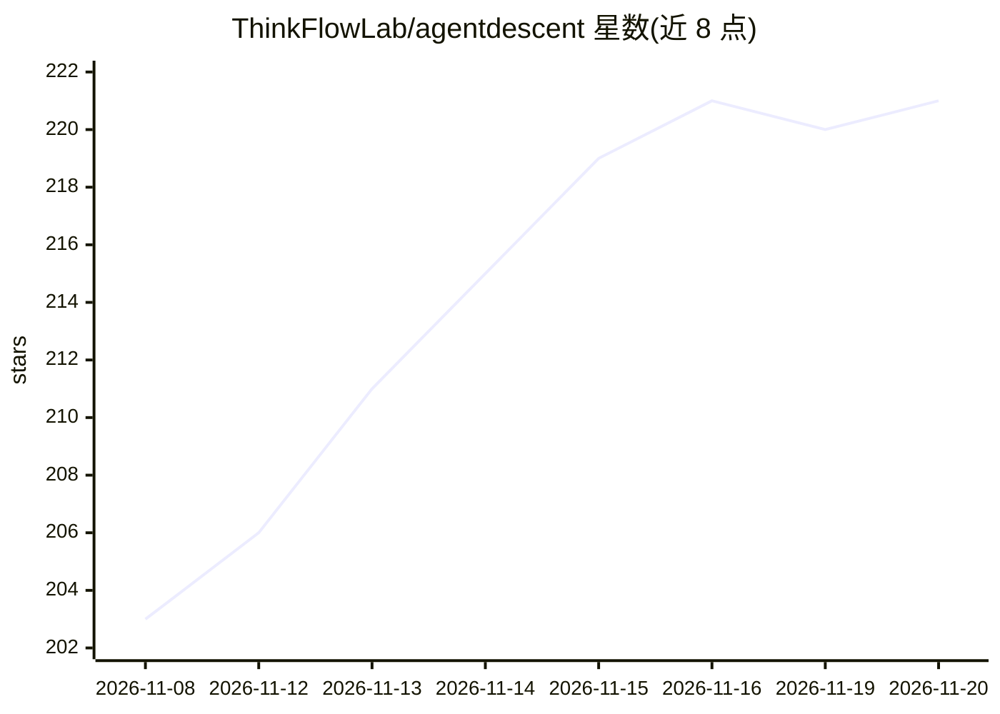

# ThinkFlowLab/agentdescent

⭐ 221 · Python · MIT · 推送 2026-11-19 · [GitHub](https://github.com/ThinkFlowLab/agentdescent) · [官网](https://thinkflowlab.github.io/agentdescent/) · 组织维护

**自进化 agent 框架：并行 worker 提出编辑、聚合器合并演进提示与技能**

面向开发者的自进化 agent 框架：N 个 worker 并行对提示、技能、agent 代码提出 diff，聚合器经五阶段合并管线提交到 git 版本化账本，留出集门控决定保留内容。以 Python 库（evolve() 单调用）与 CLI 提供，另带 MCP 服务器，可从 Claude Code、Codex、DeepSeek Harness 等宿主内调用。支持离线 demo（约 10 秒、无需 API key）。自述为研究参考实现而非生产系统，吞吐前提为可检验假设。

## 筛选速览

| 维度 | 判定 | 备注 |
|---|---|---|
| AI 角色 | `ai-ecosystem` | LLM/agent 周边工具 |
| 许可风险 | `permissive` | MIT |
| 部署形态 | `library` | 以包/库形式分发 |
| 模型依赖 | — | README 未给出锁定关系 |
| 硬件要求 | — | 无带数字的原话,不猜 |
| 安装摩擦 | `low` | 无编译、无系统依赖或容器化 |
| 成熟度 | `idea` | |

## 能力要点

- 并行 worker 提出 diff + 聚合器合并 + 留出集门控的演进循环
- evolve() 单调用、CLI 与 MCP 服务器三种使用方式
- 离线确定性 demo 与测试套件，无需 API key
- 23 个算法移植与可注册算法卡

## 适用场景

- 用自己的数据集自动演进提示词或多文件技能库
- 在 Claude Code 等 agent 宿主内运行演进流程
- 复现和扩展 agent 演进算法的研究实验

## 场景标签

`Agent 框架` `提示工程` · 领域:Agent 开发

## 证据(README 行号)

> L7: > **Gradient descent — but the parameters are agents.** AgentDescent evolves
> L11: > kept. Use it from Python with one `evolve()` call, from the CLI, or from inside

## 星数曲线

2026-11-08 203 → 2026-11-20 221（+18）

---
*卡片 v1 · prompt 1.4 · 生成 2026-11-17 · 置信度 high · 依据 README sha `e00facdb8969` · [字段定义](../../DATASET.md)*
