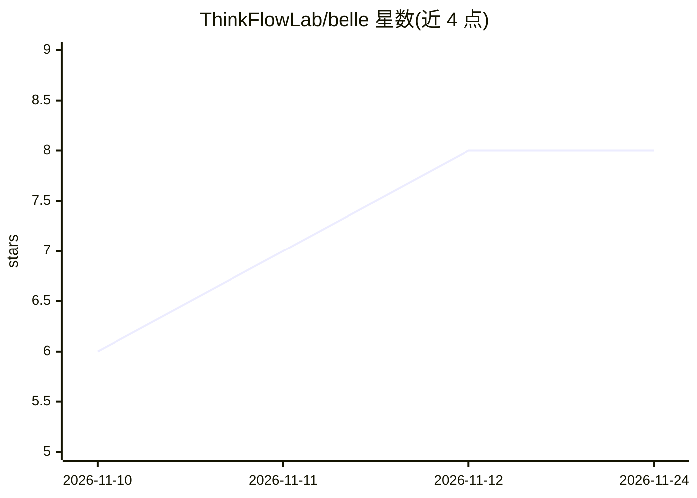

# ThinkFlowLab/belle

⭐ 8 · Python · Apache-2.0 · 推送 2026-11-06 · [GitHub](https://github.com/ThinkFlowLab/belle) · [官网](https://thinkflowlab.ai/belle/) · 组织维护

**团队聊天中的 AI 同事：回答团队知识、欢迎新人、按需发言**

Belle 部署在团队聊天平台（Slack、Discord、Mattermost、Matrix）与一个 agent harness（JiuwenSwarm、OpenCode、Docker Agent、ACP）之间，由 harness 用 chat model 执行每一轮对话，Belle 调用 task model 做发言决策与文档处理。核心机制包括：团队共享一个实例而非每人一个；ambient mode 让它只在能提供帮助时发言；按频道与成员的权限规则控制可见性，跨范围发布前需人工确认；支持定时报告与后台长任务。README 以 Python 包形式提供安装，部分平台与 harness 标注为实验性。

## 筛选速览

| 维度 | 判定 | 备注 |
|---|---|---|
| AI 角色 | `ai-native` | 本体是模型或模型工具 |
| 许可风险 | `permissive` | Apache-2.0 |
| 部署形态 | `None` |  |
| 模型依赖 | — | README 未给出锁定关系 |
| 硬件要求 | — | 无带数字的原话,不猜 |
| 安装摩擦 | `low` | 无编译、无系统依赖或容器化 |
| 成熟度 | — | 结构信号不足 |

## 能力要点

- ambient mode：读取频道内容并自行决定发言或沉默，基准测试准确率 89%
- 按频道/成员的权限规则，跨范围发布前请求人工确认或审批
- Second Brain 知识检索，在 τ-knowledge 与 EnterpriseRAG-Bench 上有评测数据
- 支持定时摘要与后台长任务（启动提示、期间继续问答、完成后发布）

## 适用场景

- 在 Slack/Mattermost 等团队频道里由 AI 回答团队知识问题
- 自动欢迎新成员并生成入群介绍
- 在频道分享文章/论文并自动生成要点摘要
- 定时发布频道决策摘要或后台跟进任务状态

## 场景标签

`聊天机器人` `RAG` · 领域:对话与助手

## 证据(README 行号)

> L4:  An AI coworker for team chat that answers from team knowledge, welcomes new members, digests shared reading, and st
> L29: Belle sits between a team's chat platforms and one agent harness. It decides when to speak and what each conversati

## 星数曲线

2026-11-10 6 → 2026-11-24 8（+2）

---
*卡片 v1 · prompt 1.4 · 生成 2026-11-20 · 置信度 mid · 依据 README sha `d5fea05cf61f` · [字段定义](../../DATASET.md)*
