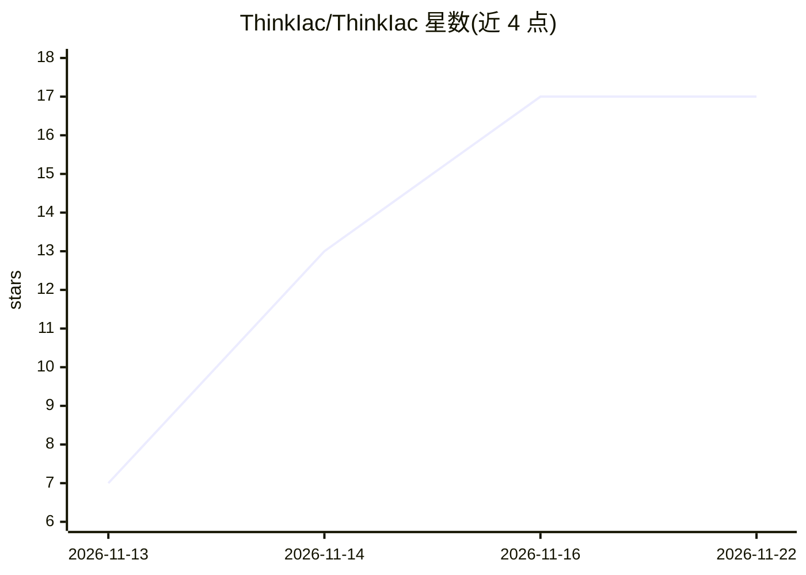

# ThinkIac/ThinkIac

⭐ 17 · JavaScript · 推送 2026-11-21 · [GitHub](https://github.com/ThinkIac/ThinkIac) · 个人维护

**面向开发者的可组合 agent 运行时基础设施（IaC）**

以基础设施即代码方式运行 agent、应用与自动化的运行时：核心 Lógos 负责包发现、生命周期与事件连接，包可通过 package.json 清单声明菜单、widget、设置页、凭据、图标与 Prisma 数据库等贡献；支持隔离模式（子进程 runner + SQLCipher 加密租户）。配套 Calendar、Tasks、Flows 可视化自动化编辑器、WhatsApp/Telegram、GitHub、Cloudflare 等包。提供 VPS 一键安装脚本（Debian/Ubuntu）、Docker Compose 与本地开发（Node.js 22+）三种部署方式，Web 界面运行于 5040 端口。许可条款尚未正式发布，README 请求通过 USDC/Polygon 自愿付费。

## 筛选速览

| 维度 | 判定 | 备注 |
|---|---|---|
| AI 角色 | `ai-ecosystem` | LLM/agent 周边工具 |
| 许可风险 | `none` | — |
| 部署形态 | `self-host` | docker 或自建部署 |
| 模型依赖 | — | README 未给出锁定关系 |
| 硬件要求 | — | 无带数字的原话,不猜 |
| 安装摩擦 | `low` | 无编译、无系统依赖或容器化 |
| 成熟度 | `idea` | |

## 能力要点

- 声明式包清单（menu/widget/settingsTab/keysTab/icon/Prisma schema）驱动的可组合扩展
- 包级数据库隔离：子进程 runner + SQLCipher 加密租户
- $() 事件总线经 hooks 传递 payload 的服务调用机制
- Flows 可视化自动化编辑器，支持事件触发、cron 与 webhook，执行持久化

## 适用场景

- 在 VPS 或 Docker 上自托管一套可扩展的 agent/自动化运行时
- 为 agent 添加 WhatsApp/Telegram/日历/任务等集成包
- 通过声明式清单与事件契约开发自定义扩展包

## 场景标签

`Agent 框架` `工作流自动化` · 领域:Agent 开发

## 证据(README 行号)

> L3: ThinkIac é infraestrutura como código para agentes, aplicativos e automações.
> L7: O Lógos descobre os pacotes, aplica o ciclo de vida e conecta eventos. Cada
> L17: O comportamento do ciclo de execução está no README do Agent

## 星数曲线

2026-11-13 7 → 2026-11-22 17（+10）

---
*卡片 v1 · prompt 1.4 · 生成 2026-11-18 · 置信度 mid · 依据 README sha `d99d72aee929` · [字段定义](../../DATASET.md)*
