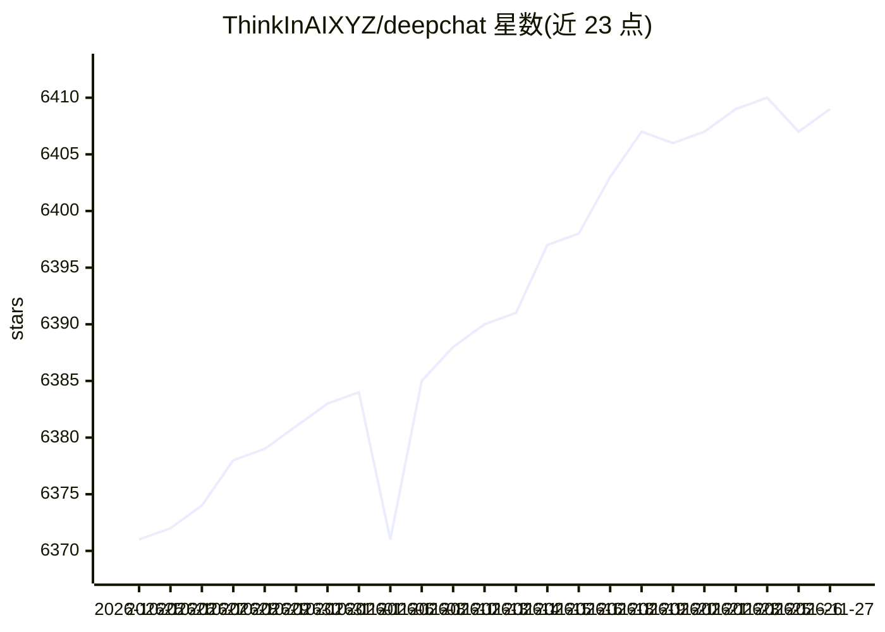

# ThinkInAIXYZ/deepchat

⭐ 6,409 · TypeScript · Apache-2.0 · 推送 2026-11-26 · [GitHub](https://github.com/ThinkInAIXYZ/deepchat) · [官网](https://deepchat.thinkinai.xyz/) · 组织维护 · 中文 README

**开源本地优先的 AI Agent 桌面客户端**

基于 Electron 的跨平台桌面应用，将云端/本地模型、MCP 服务、Skills、ACP agent 运行时与长时会话整合于一体。会话遵循 Tape.systems 理念，保留可恢复、可追溯的工作历史与 token 预算视图。支持从文件夹/ZIP/URL 安装 Skills，可从 Telegram、飞书、QQBot、Discord、微信 iLink 远程控制会话。以 Apache License 2.0 开源，支持 Windows/macOS/Linux。

## 筛选速览

| 维度 | 判定 | 备注 |
|---|---|---|
| AI 角色 | `ai-native` | 本体是模型或模型工具 |
| 许可风险 | `permissive` | Apache-2.0 |
| 部署形态 | `desktop` | 安装包/桌面程序 |
| 模型依赖 | local-ok | 支持本地模型 |
| 硬件要求 | — | 无带数字的原话,不猜 |
| 安装摩擦 | `low` | 无编译、无系统依赖或容器化 |
| 成熟度 | — | 结构信号不足 |

## 能力要点

- 支持 MCP（Resources/Prompts/Tools、多种 transport、一键安装）与 ACP agent 集成
- Tape 机制记录会话结构化历史，支持恢复、续跑与调试
- 内置 Ollama 管理：无需命令行即可下载、部署、运行本地模型
- 可从 Telegram/飞书/QQBot/Discord/微信 iLink 远程控制桌面会话

## 适用场景

- 在一个桌面应用中同时使用云端 API 和本地 Ollama 模型对话
- 为不同任务安装和启用可复用的 Skills（代码审查、Office/PDF 等）
- 通过消息应用远程查看和操控家中电脑上的 AI 会话

## 场景标签

`AI 助手` `聊天机器人` · 领域:对话与助手

## 证据(README 行号)

> L3:  DeepChat - Open-Source Local-First AI Agent Desktop Client
> L5:  DeepChat is an open-source, local-first AI agent desktop client with rich agent capabilities, designed around the T
> L24: DeepChat is a powerful open-source, local-first AI agent desktop client that brings together models, tools, Skills,

## 星数曲线

2026-10-25 6,371 → 2026-11-27 6,409（+38）

---
*卡片 v1 · prompt 1.4 · 生成 2026-11-26 · 置信度 mid · 依据 README sha `efcf896dbd03` · [字段定义](../../DATASET.md)*
