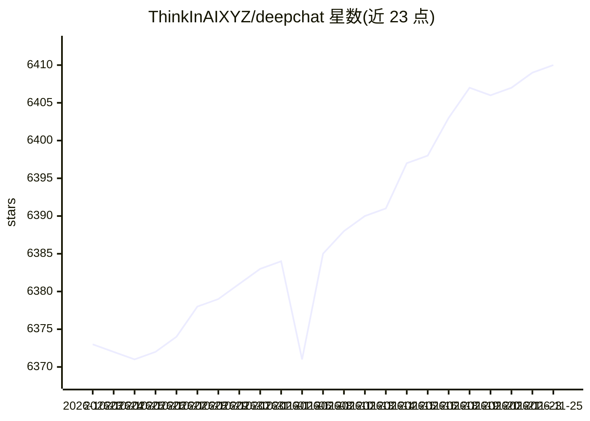

# ThinkInAIXYZ/deepchat

⭐ 6,410 · TypeScript · Apache-2.0 · 推送 2026-11-23 · [GitHub](https://github.com/ThinkInAIXYZ/deepchat) · [官网](https://deepchat.thinkinai.xyz/) · 组织维护 · 中文 README

**本地优先的 AI Agent 桌面客户端，整合模型与工具**

基于 Electron 的开源桌面客户端，将云端 API 模型与本地 Ollama 模型统一接入，提供 agent 会话、MCP 服务、可安装 Skills、ACP agent 集成与长会话管理；会话遵循 Tape.systems 理念保存可恢复、可追溯的工作历史。支持从 Telegram、飞书、QQBot、Discord、微信 iLink 远程控制会话。提供 Windows/macOS/Linux 安装包，Apache 2.0 许可。

## 筛选速览

| 维度 | 判定 | 备注 |
|---|---|---|
| AI 角色 | `ai-ecosystem` | LLM/agent 周边工具 |
| 许可风险 | `permissive` | Apache-2.0 |
| 部署形态 | `desktop` | 安装包/桌面程序 |
| 模型依赖 | local-ok | 支持本地模型 |
| 硬件要求 | — | 无带数字的原话,不猜 |
| 安装摩擦 | `low` | 无编译、无系统依赖或容器化 |
| 成熟度 | — | 结构信号不足 |

## 能力要点

- 统一接入主流云 LLM 与本地 Ollama 模型（README 列出 60+ 供应商）
- MCP 完整支持：Resources/Prompts/Tools、多种传输方式、一键安装
- Skills 可从文件夹/ZIP/URL 安装，与 Claude Code、Codex、Cursor 等工具互通导入导出
- 从 Telegram/飞书/QQBot/Discord/微信 iLink 远程绑定与控制会话

## 适用场景

- 在一个桌面应用中同时使用云端 API 和本地模型对话
- 通过 MCP 与 Skills 扩展代码审查、文档处理等任务能力
- 离开电脑时用消息应用远程操控桌面上的 agent 会话

## 场景标签

`AI 助手` · 领域:对话与助手

## 证据(README 行号)

> L3:  DeepChat - Open-Source Local-First AI Agent Desktop Client
> L24: DeepChat is a powerful open-source, local-first AI agent desktop client that brings together models, tools, Skills,
> L42: - **Unified Multi-Model Management**: One application supports mainstream cloud LLMs and local Ollama models, elimi

## 星数曲线

2026-10-23 6,373 → 2026-11-25 6,410（+37）

---
*卡片 v1 · prompt 1.4 · 生成 2026-11-25 · 置信度 mid · 依据 README sha `17d351e80002` · [字段定义](../../DATASET.md)*
