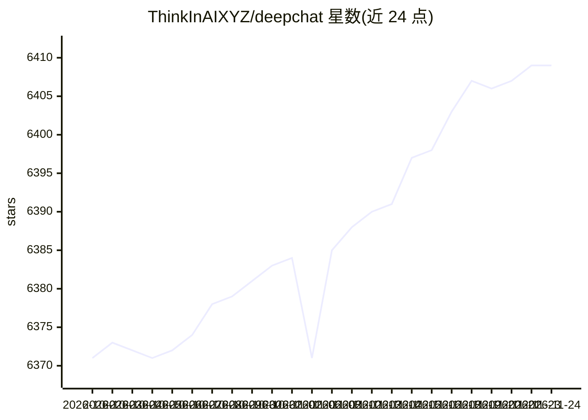

# ThinkInAIXYZ/deepchat

⭐ 6,409 · TypeScript · Apache-2.0 · 推送 2026-11-22 · [GitHub](https://github.com/ThinkInAIXYZ/deepchat) · [官网](https://deepchat.thinkinai.xyz/) · 组织维护 · 中文 README

**开源本地优先 AI Agent 桌面客户端，统一管理模型与 Agent**

基于 Electron 的开源（Apache-2.0）AI 桌面客户端，将云 API 模型、本地 Ollama 模型、Skills、ACP Agent 运行时与会话 Tape 汇聚在同一桌面应用中。会话按 Tape.systems 理念保留可恢复、可追溯的工作历史；支持 MCP 协议（Resources/Prompts/Tools、多种传输）、可安装的 Skills（兼容 Claude Code/Codex/Cursor 等格式导入导出）、以及从 Telegram/飞书/QQBot/Discord/微信 iLink 远程控制会话。提供 Windows/macOS/Linux 安装包，支持 API key 与本地 Ollama 两种模型接入方式。

## 筛选速览

| 维度 | 判定 | 备注 |
|---|---|---|
| AI 角色 | `ai-native` | 本体是模型或模型工具 |
| 许可风险 | `permissive` | Apache-2.0 |
| 部署形态 | `desktop` | 安装包/桌面程序 |
| 模型依赖 | local-ok | 支持本地模型 |
| 硬件要求 | — | 无带数字的原话,不猜 |
| 安装摩擦 | `low` | 无编译、无系统依赖或容器化 |
| 成熟度 | — | 结构信号不足 |

## 能力要点

- 统一接入数十家云模型提供商与本地 Ollama 管理
- 支持 MCP 协议与按会话启用的 Skills 安装/导入导出
- ACP Agent 以模型选择器一等条目方式集成
- Tape 会话记录支持恢复、追踪与 token 预算查看

## 适用场景

- 在一个桌面应用中同时使用云端 API 与本地模型对话
- 为代码审查、文档、Office/PDF 等任务安装可复用 Skills
- 通过 Telegram/飞书等消息应用远程操控桌面会话

## 场景标签

`AI 助手` · 领域:对话与助手

## 证据(README 行号)

> L24: DeepChat is a powerful open-source, local-first AI agent desktop client that brings together models, tools, Skills,
> L40: - **Strong MCP Support**: Support Resources, Prompts, Tools, multiple transports, inMemory services, and one-click 
> L103: - 🌐 **Multiple Cloud LLM Provider Support**: DeepSeek, OpenAI, Moonshot/Kimi, Grok, Gemini, Anthropic, and more

## 星数曲线

2026-10-22 6,371 → 2026-11-24 6,409（+38）

---
*卡片 v1 · prompt 1.4 · 生成 2026-11-22 · 置信度 mid · 依据 README sha `05a7b12531fd` · [字段定义](../../DATASET.md)*
