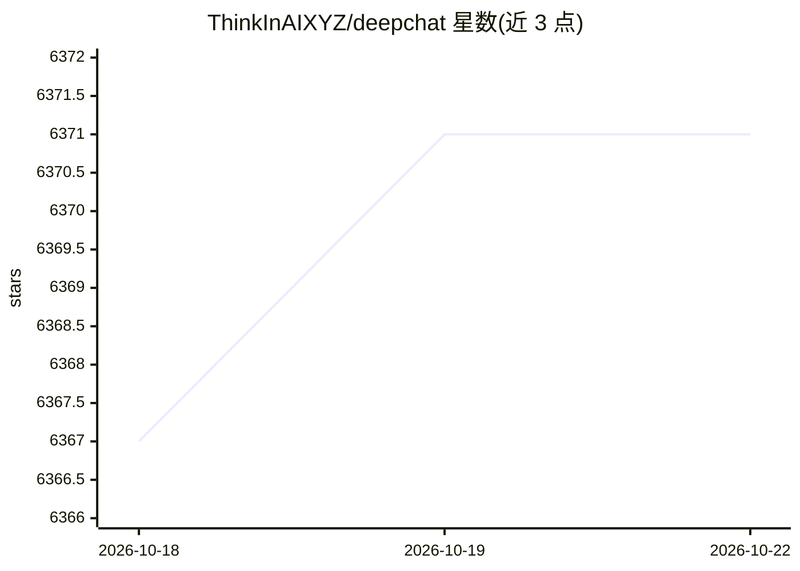

# ThinkInAIXYZ/deepchat

⭐ 6,373 · TypeScript · Apache-2.0 · 推送 2026-10-22 · [GitHub](https://github.com/ThinkInAIXYZ/deepchat) · [官网](https://deepchat.thinkinai.xyz/) · 组织维护 · 中文 README

**开源本地优先的 AI Agent 桌面客户端，聚合多云与本地模型**

基于 Electron 的跨平台（Windows/macOS/Linux）AI 桌面客户端，聚合 DeepSeek、OpenAI、Gemini、Anthropic 等云模型与本地 Ollama。按 Tape.systems 理念保存会话过程，使上下文、工具调用与结果可恢复、可追溯；支持可安装的 Skills（兼容 Claude Code、Cursor 等工具导入导出）、MCP（Resources/Prompts/Tools）、ACP 外部 agent 接入，以及通过 Telegram、飞书、QQBot、Discord、微信 iLink 远程控制会话。本地存储数据，Apache 2.0 许可。

## 筛选速览

| 维度 | 判定 | 备注 |
|---|---|---|
| AI 角色 | `ai-native` | 本体是模型或模型工具 |
| 许可风险 | `permissive` | Apache-2.0 |
| 部署形态 | `desktop` | 安装包/桌面程序 |
| 模型依赖 | local-ok | 支持本地模型 |
| 硬件要求 | — | 无带数字的原话,不猜 |
| 安装摩擦 | `low` | 无编译、无系统依赖或容器化 |
| 成熟度 | — | 结构信号不足 |

## 能力要点

- Tape/Trace 会话记录：可恢复、可追溯、可查看 token 预算
- Skills 安装/导入导出，兼容 Claude Code、Cursor、Windsurf 等工具
- MCP 全量支持（Resources/Prompts/Tools、多传输方式、DeepLink 一键安装）
- 通过 Telegram、飞书、QQBot、Discord、微信 iLink 远程控制会话

## 适用场景

- 在一个桌面应用内统一使用多家云模型和本地 Ollama 模型
- 通过消息应用远程控制家中/办公电脑上的 AI 会话
- 在长时运行的 agent 会话中保存并回溯工作过程
- 为代码评审、文档、Office/PDF 等任务安装领域 Skills

## 场景标签

`AI 助手` · 领域:对话与助手

## 证据(README 行号)

> L48: DeepChat is a powerful open-source, local-first AI agent desktop client that brings together models, tools, Skills,
> L50: DeepChat's sessions and agent processes follow the Tape.systems philosophy: keep the process, so context, tool call
> L103: ### Start Conversations

## 星数曲线

2026-10-18 6,367 → 2026-10-22 6,371（+4）

---
*卡片 v1 · prompt 1.4 · 生成 2026-10-20 · 置信度 mid · 依据 README sha `c133a71205a7` · [字段定义](../../DATASET.md)*
