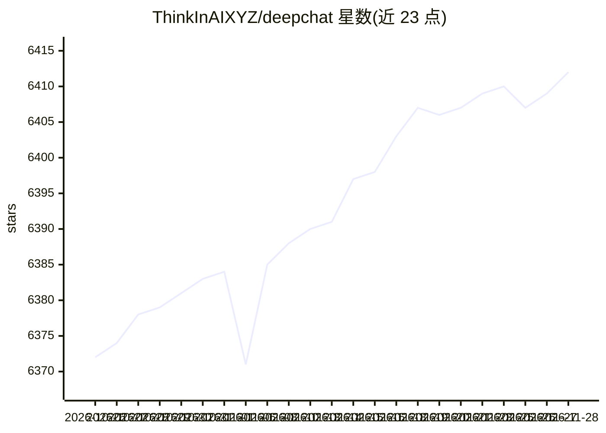

# ThinkInAIXYZ/deepchat

⭐ 6,412 · TypeScript · Apache-2.0 · 推送 2026-11-27 · [GitHub](https://github.com/ThinkInAIXYZ/deepchat) · [官网](https://deepchat.thinkinai.xyz/) · 组织维护 · 中文 README

**连接云端与本地大模型的开源本地优先 AI Agent 桌面客户端**

基于 Electron 的跨平台桌面应用，将模型、MCP 服务、Skills、ACP agent 运行时与会话整合在一起。会话遵循 Tape.systems 理念，保留可恢复、可追溯、可检查的工作历史与 token 预算。支持从文件夹/ZIP/URL 安装 Skills 并与多种兼容工具互导，支持通过 Telegram、飞书、QQBot、Discord、微信 iLink 远程控制会话。提供 Windows exe、macOS dmg、Linux AppImage/deb 安装包与 Homebrew 安装方式。

## 筛选速览

| 维度 | 判定 | 备注 |
|---|---|---|
| AI 角色 | `ai-native` | 本体是模型或模型工具 |
| 许可风险 | `permissive` | Apache-2.0 |
| 部署形态 | `desktop` | 安装包/桌面程序 |
| 模型依赖 | local-ok | 支持本地模型 |
| 硬件要求 | — | 无带数字的原话,不猜 |
| 安装摩擦 | `low` | 无编译、无系统依赖或容器化 |
| 成熟度 | — | 结构信号不足 |

## 能力要点

- MCP 全支持：Resources/Prompts/Tools、多传输方式、inMemory 服务与一键安装
- Skills 体系：可从文件夹/ZIP/URL 安装，兼容 Agent Skills 规范并与多种编码工具互导
- ACP 集成：外部 agent 以一等条目出现在模型选择器中
- 远程控制：绑定消息应用端点后可切换模型、停止生成、远程打开桌面会话

## 适用场景

- 在一个桌面应用中统一使用多家云端模型与本地 Ollama 模型
- 通过消息应用在离开桌面时远程操控 AI 会话
- 为代码审查、文档、Office/PDF 等任务安装领域 Skills

## 场景标签

`AI 助手` `聊天机器人` · 领域:对话与助手

## 证据(README 行号)

> L3:  DeepChat - Open-Source Local-First AI Agent Desktop Client
> L5:  DeepChat is an open-source, local-first AI agent desktop client with rich agent capabilities, designed around the T
> L24: DeepChat is a powerful open-source, local-first AI agent desktop client that brings together models, tools, Skills,

## 星数曲线

2026-10-26 6,372 → 2026-11-28 6,412（+40）

---
*卡片 v1 · prompt 1.4 · 生成 2026-11-28 · 置信度 mid · 依据 README sha `171d13cdc447` · [字段定义](../../DATASET.md)*
