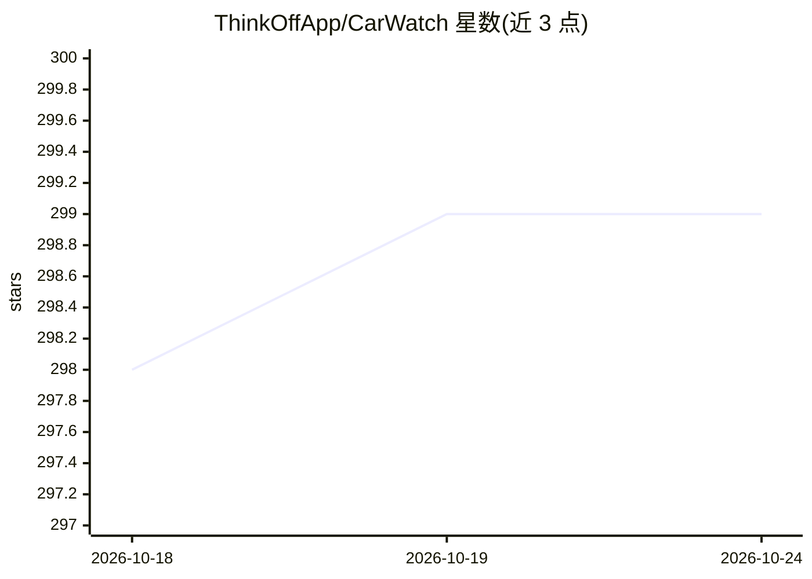

# ThinkOffApp/CarWatch

⭐ 299 · Python · AGPL-3.0 · 推送 2026-10-09 · [GitHub](https://github.com/ThinkOffApp/CarWatch) · [官网](https://carwatch.dev) · 个人维护

**让汽车成为聊天室 agent 的树莓派本地 AI 车载系统**

在树莓派 5（16GB）上离线运行量化 LLM（默认 Qwen3.6-35B，约 3.5 tok/s）的车载 agent：读取 OBD 与厂商云数据，以聊天室成员身份发送出发/到达、行程摘要与行车记录仪片段；支持 whisper.cpp 全离线免唤醒语音问答，从随车 489 页车主手册做词法 RAG 并引用页码，感知不到的信息会明说。全部代码为 Python 标准库，git clone 即可运行；v0.5 起可在手机仪表盘上列出并切换本机 .gguf 模型，含 RAM 装不下拒载、切换不打断生成、失败回滚三条护栏。面向自建智能体生态的个体开发者/爱好者。

## 筛选速览

| 维度 | 判定 | 备注 |
|---|---|---|
| AI 角色 | `ai-native` | 本体是模型或模型工具 |
| 许可风险 | `viral` | AGPL-3.0 |
| 部署形态 | `library` | 以包/库形式分发 |
| 模型依赖 | local-ok | 支持本地模型 |
| 硬件要求 | — | 无带数字的原话,不猜 |
| 安装摩擦 | `low` | 无编译、无系统依赖或容器化 |
| 成熟度 | — | 结构信号不足 |

## 能力要点

- Pi 5 上离线运行 35B 量化模型（3.5 tok/s 生成 / 25+ tok/s prompt，65°C）
- 车主手册词法 RAG 带页码引用，手册未记载则拒答
- 能量 VAD + whisper.cpp 全离线免唤醒语音问答
- 零第三方依赖（纯 Python 标准库），git clone 即运行，systemd 自启
- 手机端模型切换面板，含拒载/不打断/回滚三条护栏

## 适用场景

- 开车时用语音向汽车查询车况、胎压、故障码与手册内容
- 让汽车作为 agent 在家庭聊天室里播报行程与异常事件
- 无信号车库/隧道中继续使用离线语音、手册问答与仪表盘
- 多 agent 家庭中与房屋、手表等 agent 联动（预热、充电时机等）

## 场景标签

`语音 Agent` `RAG` · 领域:对话与助手

## 证据(README 行号)

> L18: **Your car as a chat-room agent — fully offline.** A Raspberry Pi 5 rides in the
> L27: - 🧠 **Qwen3.6-35B-A3B** (Unsloth UD-Q3_K_S dynamic quant, 14.3 GB) at
> L37: - 🎙️ **Hands-free voice**: a continuous listener (energy VAD → whisper.cpp,

## 星数曲线

2026-10-18 298 → 2026-10-24 299（+1）

---
*卡片 v1 · prompt 1.4 · 生成 2026-10-21 · 置信度 mid · 依据 README sha `aabb33b7dba9` · [字段定义](../../DATASET.md)*
