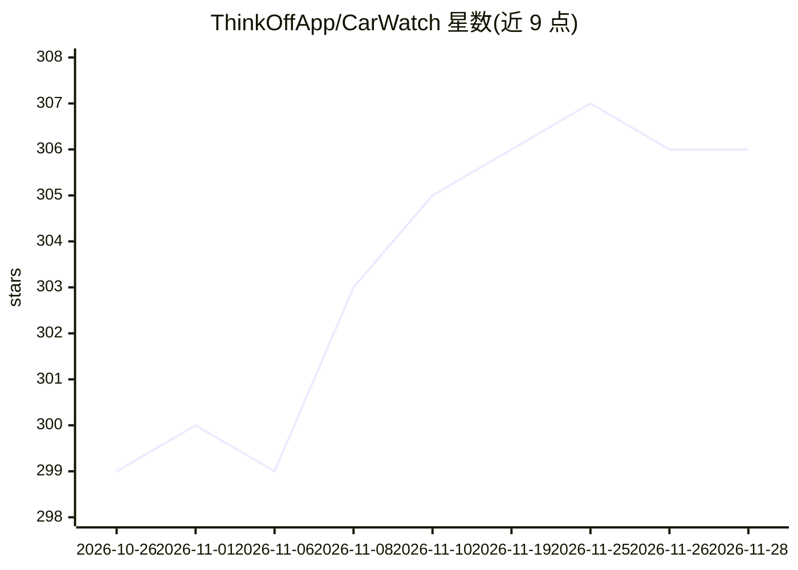

# ThinkOffApp/CarWatch

⭐ 306 · Python · AGPL-3.0 · 推送 2026-11-27 · [GitHub](https://github.com/ThinkOffApp/CarWatch) · [官网](https://carwatch.dev) · 个人维护

**让汽车成为聊天群里的离线本地 AI agent（树莓派 5）**

在车载树莓派 5 上本地运行 35B 参数量化模型，汽车以 agent 身份加入 GroupMind 聊天房间，主动播报出发/到达、行程摘要、行车记录仪事件片段，并可通过手机或手表回复与审批。回答基于随车附带的 489 页车主手册的本地 RAG（带页码引用），语音输入经 energy VAD 与 whisper.cpp 全程在设备上处理；仪表盘可在手机上切换 `.gguf` 模型并显示设备实测 token/s。全代码仅用 Python 标准库，`git clone` 即运行； systemd 开机自启，通过 Tailscale 接入家中 Home Assistant 读取厂商云端数据。

## 筛选速览

| 维度 | 判定 | 备注 |
|---|---|---|
| AI 角色 | `ai-native` | 本体是模型或模型工具 |
| 许可风险 | `viral` | AGPL-3.0 |
| 部署形态 | `library` | 以包/库形式分发 |
| 模型依赖 | local-ok | 支持本地模型 |
| 硬件要求 | — | 无带数字的原话,不猜 |
| 安装摩擦 | `low` | 无编译、无系统依赖或容器化 |
| 成熟度 | — | 结构信号不足 |

## 能力要点

- 35B 模型在 Pi 5 上完全离线运行（Q3_K_S 量化，14.3 GB）
- 基于 489 页车主手册的本地 RAG 回答，拒绝手册未涵盖的问题
- 每题实时读取温度/内存/网络等自身状态，构建接地系统提示词
- 手机仪表盘一键切换 `.gguf` 模型，附设备实测基准表与换模型护栏

## 适用场景

- 免手持向汽车提问，如黄胎压灯含义与实际胎压
- 车辆在群聊中主动播报故障码、锁车状态与行程摘要
- 车库/隧道等无信号环境继续使用语音问答与仪表盘
- 通过手机远程锁门关窗等受限安全操作

## 场景标签

`RAG` `语音识别` `推理引擎` · 领域:知识与检索

## 证据(README 行号)

> L18: **Your car as a chat-room agent — fully offline.** A Raspberry Pi 5 rides in the
> L31:  citations (lexical RAG, ships on the SD card) — and *refuses* to answer
> L37: - 🎙️ **Hands-free voice**: a continuous listener (energy VAD → whisper.cpp,

## 星数曲线

2026-10-26 299 → 2026-11-28 306（+7）

---
*卡片 v1 · prompt 1.4 · 生成 2026-11-28 · 置信度 mid · 依据 README sha `bf210ee3195f` · [字段定义](../../DATASET.md)*
