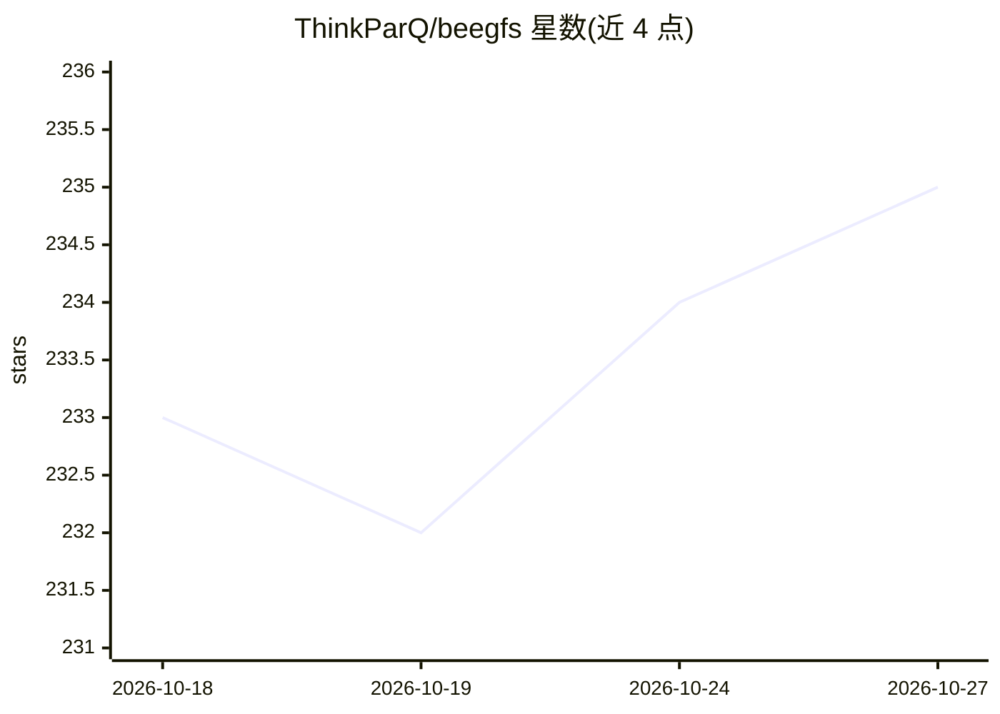

# ThinkParQ/beegfs

⭐ 235 · C++ · NOASSERTION · 推送 2026-08-19 · [GitHub](https://github.com/ThinkParQ/beegfs) · [官网](https://www.beegfs.io) · 组织维护

**面向 HPC 集群的并行文件系统，解决 I/O 密集型工作负载存储**

BeeGFS（原 FhGFS）是并行集群文件系统，包含元数据服务、存储服务、客户端内核模块与文件系统检查器（C/C++），另有 Rust 编写的 Management 服务与 Go 编写的命令行工具（分仓 beegfs-rust / beegfs-go）。面向需要高吞吐共享存储的 HPC/Linux 集群管理员与开发者。提供 x86 与 ARM 的预编译包，也可从源码构建 RPM/DEB 包或直接 make 构建；构建需要 libibverbs、kernel-devel 等系统依赖。本 README 未涉及任何 AI 功能。

## 筛选速览

| 维度 | 判定 | 备注 |
|---|---|---|
| AI 角色 | `ai-enhanced` | 去掉 AI 部分产品仍成立 |
| 许可风险 | `none` | NOASSERTION |
| 部署形态 | `None` |  |
| 模型依赖 | — | README 未给出锁定关系 |
| 硬件要求 | — | 无带数字的原话,不猜 |
| 安装摩擦 | `medium` | 含编译或系统依赖之一 |
| 成熟度 | — | 结构信号不足 |

## 能力要点

- 元数据/存储/客户端内核模块等 C/C++ 组件与 Rust、Go 新组件的分仓结构
- 提供 x86 与 ARM 的多发行版预编译包
- Makefile 支持构建 RPM/DEB 包、distcc 并行编译

## 适用场景

- HPC 集群部署高吞吐并行共享存储
- 为 I/O 密集型工作负载提供 POSIX 文件系统
- 从源码定制构建服务端组件与客户端内核模块

## 场景标签

 · 领域:HPC/分布式存储

## 证据(README 行号)

> L1: # BeeGFS Parallel File System
> L2: BeeGFS (formerly FhGFS) is the leading parallel cluster file system, developed with a strong focus
> L3: on performance and designed for very easy installation and management. If I/O intensive workloads

## 星数曲线

2026-10-18 233 → 2026-10-27 235（+2）

---
*卡片 v1 · prompt 1.4 · 生成 2026-10-22 · 置信度 low · 依据 README sha `4082b93a1983` · [字段定义](../../DATASET.md)*
