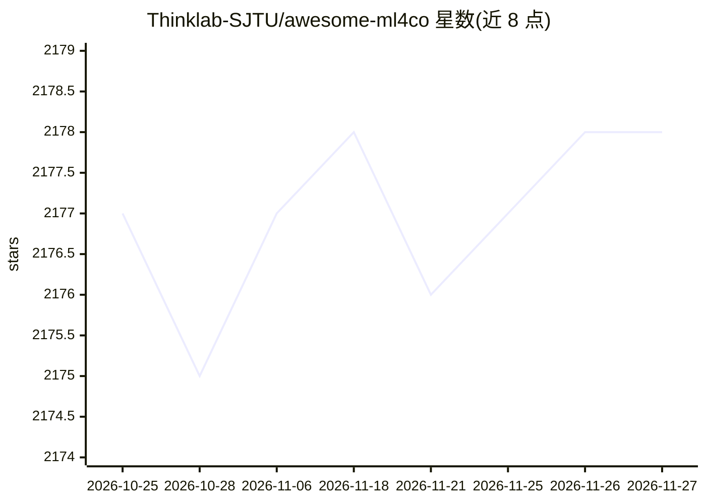

# Thinklab-SJTU/awesome-ml4co

⭐ 2,178 · Python · 推送 2026-11-25 · [GitHub](https://github.com/Thinklab-SJTU/awesome-ml4co) · 组织维护

**机器学习求解组合优化的论文资源清单**

由上海交通大学 Thinklab 成员维护的论文列表，收录利用机器学习技术求解组合优化问题的文献资源，按综述与具体问题（TSP、JSSP、图匹配、MIP、SAT 等 36 个问题类别）组织，条目标注发表会议/期刊、年份与作者，部分附代码链接；另提供 TSP 等基准上的性能对比图表，并以 ⭐ 标记 Thinklab 自身贡献的工作。面向从事运筹优化与机器学习交叉研究的读者。

## 筛选速览

| 维度 | 判定 | 备注 |
|---|---|---|
| AI 角色 | `ai-knowledge` | 知识聚合/清单类 |
| 许可风险 | `none` | — |
| 部署形态 | `None` |  |
| 模型依赖 | — | README 未给出锁定关系 |
| 硬件要求 | — | 无带数字的原话,不猜 |
| 安装摩擦 | `low` | 无编译、无系统依赖或容器化 |
| 成熟度 | — | 结构信号不足 |

## 能力要点

- 按 36 类组合优化问题组织的论文分类索引
- 收录综述与具体问题论文，部分条目附代码链接
- TSP-500/1000 基准结果图表（来自原始论文数据）
- 以 ⭐ 标记 Thinklab 成员贡献的条目

## 适用场景

- 查找机器学习求解组合优化方向的综述与代表论文
- 调研 TSP、MIP 等特定问题的神经网络求解方法
- 查看 TSP 基准上的方法性能对比数据

## 场景标签

`精选清单` · 领域:学习与行业

## 证据(README 行号)

> L1: # Awesome Machine Learning for Combinatorial Optimization Resources
> L2: We would like to maintain a list of resources that utilize machine learning technologies to solve combinatorial opti
> L6: *Maintained by members in SJTU-Thinklab: Chang Liu, Runzhong Wang, Jiayi Zhang, Zelin Zhao, Haoyu Geng, Tianzhe Wang

## 星数曲线

2026-10-25 2,177 → 2026-11-27 2,178（+1）

---
*卡片 v1 · prompt 1.4 · 生成 2026-11-26 · 置信度 high · 依据 README sha `86af96b9c7ef` · [字段定义](../../DATASET.md)*
