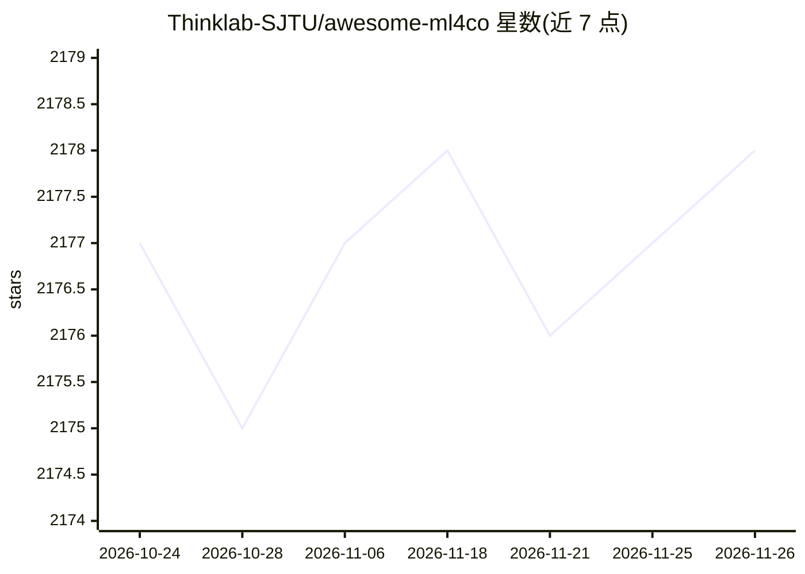

# Thinklab-SJTU/awesome-ml4co

⭐ 2,178 · Python · 推送 2026-11-25 · [GitHub](https://github.com/Thinklab-SJTU/awesome-ml4co) · 组织维护 · 中文 README

**机器学习求解组合优化问题的论文资源清单**

由上海交通大学 Thinklab 团队成员维护的资源列表，收录利用机器学习技术求解组合优化问题的论文。内容按综述与 36 类问题组织，覆盖 TSP、JSSP、图匹配、MIP、车辆路径等；部分条目标注 code 链接，Thinklab 成员贡献的条目以星号标记。TSP 部分附基准结果图表（Beta），由 CSV 数据生成，展示各方法在共同基准上的性能演进。

## 筛选速览

| 维度 | 判定 | 备注 |
|---|---|---|
| AI 角色 | `ai-knowledge` | 知识聚合/清单类 |
| 许可风险 | `none` | — |
| 部署形态 | `None` |  |
| 模型依赖 | — | README 未给出锁定关系 |
| 硬件要求 | — | 无带数字的原话,不猜 |
| 安装摩擦 | `low` | 无编译、无系统依赖或容器化 |
| 成熟度 | — | 结构信号不足 |

## 能力要点

- 按 36 类组合优化问题组织的论文分类目录
- 综述部分收录 20 篇调研论文
- TSP 基准结果图表由 data/benchmark_results.csv 生成（Beta）
- 部分条目附 code 链接

## 适用场景

- 调研机器学习求解组合优化的文献进展
- 按问题类型（如 TSP、MIP）查找相关论文与代码
- 了解 TSP 等问题的基准性能演进

## 场景标签

`精选清单` `科研工具` · 领域:学习与行业

## 证据(README 行号)

> L1: # Awesome Machine Learning for Combinatorial Optimization Resources
> L2: We would like to maintain a list of resources that utilize machine learning technologies to solve combinatorial opti
> L6: *Maintained by members in SJTU-Thinklab: Chang Liu, Runzhong Wang, Jiayi Zhang, Zelin Zhao, Haoyu Geng, Tianzhe Wang

## 星数曲线

2026-10-24 2,177 → 2026-11-26 2,178（+1）

---
*卡片 v1 · prompt 1.4 · 生成 2026-11-23 · 置信度 high · 依据 README sha `57141a67ddc3` · [字段定义](../../DATASET.md)*
