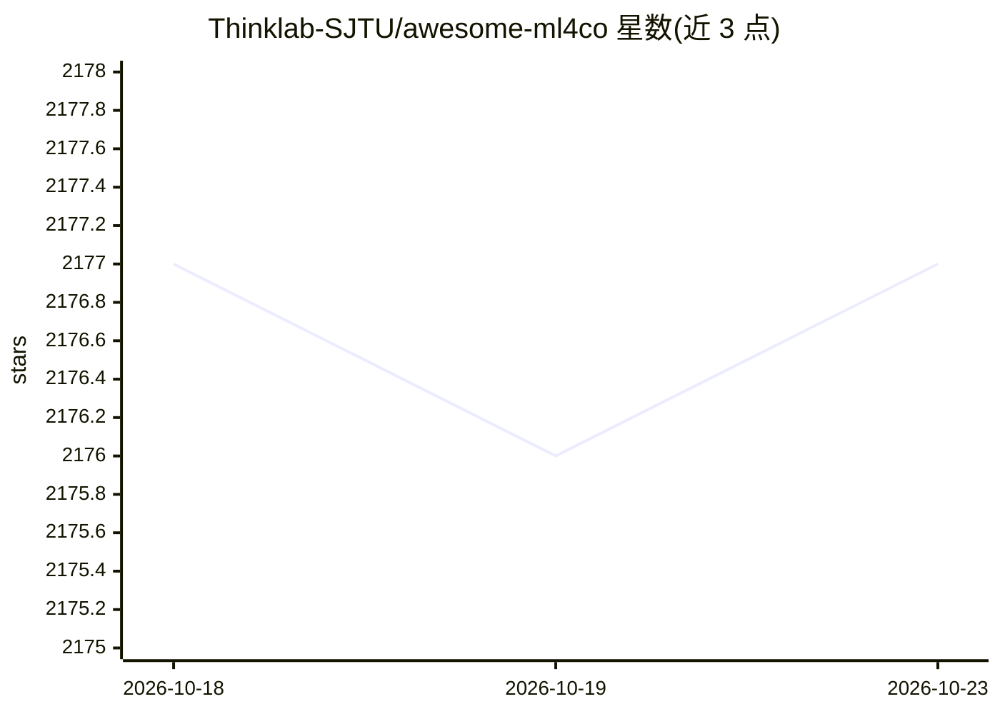

# Thinklab-SJTU/awesome-ml4co

⭐ 2,177 · Python · 推送 2026-10-10 · [GitHub](https://github.com/Thinklab-SJTU/awesome-ml4co) · 组织维护 · 中文 README

**机器学习求解组合优化的论文资源清单（36 类问题）**

上海交大 Thinklab 维护的 awesome 论文清单，收录用机器学习技术求解组合优化问题的研究资源：按 TSP、JSSP、图匹配、MIP、EDA、Predict+Optimize 等 36 个问题类别组织，含综述论文与各问题下的论文条目（附 paper/code 链接与 Thinklab 自贡献的 ⭐ 标记）。TSP 部分带基于原论文数据的基准结果图表（Beta 功能，硬件未归一化）。README 同时发布博士后招聘信息。仅作编目，不含可运行代码或安装步骤。

## 筛选速览

| 维度 | 判定 | 备注 |
|---|---|---|
| AI 角色 | `ai-knowledge` | 知识聚合/清单类 |
| 许可风险 | `none` | — |
| 部署形态 | `None` |  |
| 模型依赖 | — | README 未给出锁定关系 |
| 硬件要求 | — | 无带数字的原话,不猜 |
| 安装摩擦 | `low` | 无编译、无系统依赖或容器化 |
| 成熟度 | `idea` | |

## 能力要点

- 按 36 个组合优化问题类别组织论文条目
- 收录 20 篇综述论文
- TSP 部分提供由原论文数据生成的基准结果图表（Beta）
- Thinklab 自贡献工作以 ⭐ 标记

## 适用场景

- 查找特定组合优化问题（如 TSP、MIP）的机器学习方法论文
- 了解神经组合优化领域的综述脉络
- 对比 TSP 基准上各方法的表现数据

## 场景标签

`精选清单` · 领域:学习与行业

## 证据(README 行号)

> L1: # Awesome Machine Learning for Combinatorial Optimization Resources
> L2: We would like to maintain a list of resources that utilize machine learning technologies to solve combinatorial opti

## 星数曲线

2026-10-18 2,177 → 2026-10-23 2,177（+0）

---
*卡片 v1 · prompt 1.4 · 生成 2026-10-21 · 置信度 high · 依据 README sha `9d97e0785ae4` · [字段定义](../../DATASET.md)*
