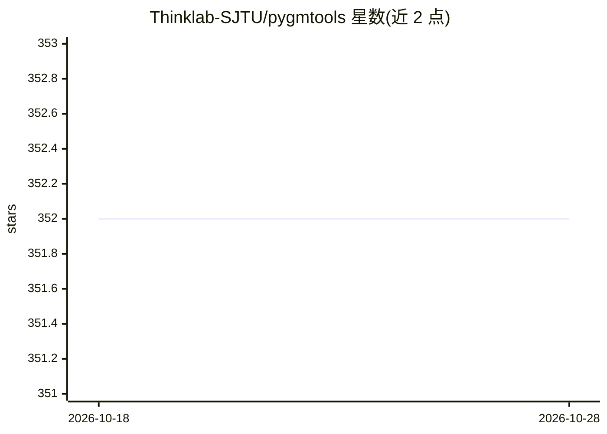

# Thinklab-SJTU/pygmtools

⭐ 352 · Python · NOASSERTION · 推送 2026-06-05 · [GitHub](https://github.com/Thinklab-SJTU/pygmtools) · [官网](https://pygmtools.readthedocs.io/) · 组织维护 · 中文 README

**Python 图匹配求解器库：给研究者的组合优化与深度学习图匹配工具**

由上海交通大学 ThinkLab 开发维护的 Python 图匹配工具库，为模式识别与数据挖掘研究者提供图节点对应关系求解能力。收录线性/二次/多图组合求解器（Sinkhorn、Hungarian、谱方法、CAO 等）与 PCA-GM、NGM、GENN-A* 等神经图匹配求解器，预训练模型可自动下载或从 HuggingFace/网盘手动获取。支持 numpy/pytorch/paddle/jittor/tensorflow/mindspore 多后端统一 API，numpy 为默认 CPU 后端。发表于 JMLR 2024。

## 筛选速览

| 维度 | 判定 | 备注 |
|---|---|---|
| AI 角色 | `ai-native` | 本体是模型或模型工具 |
| 许可风险 | `none` | NOASSERTION |
| 部署形态 | `library` | 以包/库形式分发 |
| 模型依赖 | — | README 未给出锁定关系 |
| 硬件要求 | `cpu-ok` | |
| 安装摩擦 | `low` | 无编译、无系统依赖或容器化 |
| 成熟度 | — | 结构信号不足 |

## 能力要点

- 传统组合求解器与深度学习神经求解器两类图匹配算法
- 多后端统一 API：numpy/pytorch/paddle/jittor/tensorflow/mindspore
- 神经求解器预训练模型自动下载（HuggingFace/Google Drive/百度网盘）
- 附带图匹配基准数据接口与 ThinkMatch 模型实现仓库

## 适用场景

- 在模式识别研究中求解图节点对应关系
- 用不同深度学习框架后端运行可微图匹配算法
- 复现与基准评测深度图匹配模型

## 场景标签

 · 领域:机器学习/组合优化

## 证据(README 行号)

> L33: * *Support various solvers*, including traditional combinatorial solvers (including linear, quadratic, and multi-gr
> L34:  and novel deep learning-based solvers;
> L84: * Neural Graph Matching Solvers

## 星数曲线

2026-10-18 352 → 2026-10-28 352（+0）

---
*卡片 v1 · prompt 1.4 · 生成 2026-10-21 · 置信度 high · 依据 README sha `752b5d70e865` · [字段定义](../../DATASET.md)*
