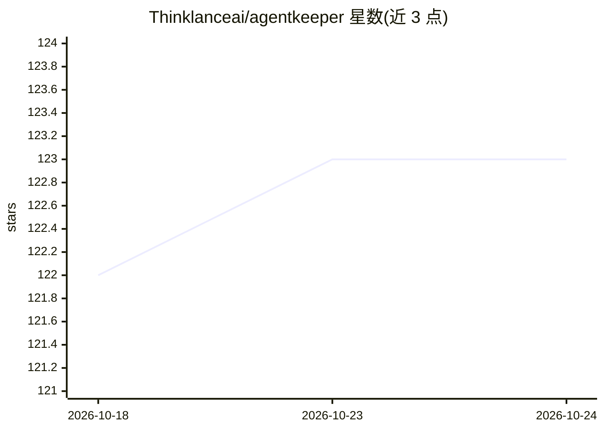

# Thinklanceai/agentkeeper

⭐ 122 · Python · MIT · 推送 2026-06-09 · [GitHub](https://github.com/Thinklanceai/agentkeeper) · [官网](https://pypi.org/project/agentkeeper-ai/) · 组织维护

**长生命周期 AI agent 的认知连续性基础设施库**

Python 库（pip 安装，MIT），为长生命周期 agent 提供跨模型/跨重启的记忆与身份保持：事实/事件/原则分层记忆、语义召回（默认本地 sentence-transformers）、认知压缩（衰减/合并/矛盾仲裁）、图三元组、TTL 过期、AES 加密 SQLite 存储、checkpoint/restore。支持切换 Anthropic/OpenAI/Gemini/Ollama 提供商而保持同一记忆，内置 MCP 服务器接入 Claude Desktop 等客户端，并可导入 ChatGPT/Claude/Gemini 官方数据导出比对平台记忆。零必需依赖，Postgres 为存根。

## 筛选速览

| 维度 | 判定 | 备注 |
|---|---|---|
| AI 角色 | `ai-ecosystem` | LLM/agent 周边工具 |
| 许可风险 | `permissive` | MIT |
| 部署形态 | `library` | 以包/库形式分发 |
| 模型依赖 | local-ok | 支持本地模型 |
| 硬件要求 | — | 无带数字的原话,不猜 |
| 安装摩擦 | `low` | 无编译、无系统依赖或容器化 |
| 成熟度 | — | 结构信号不足 |

## 能力要点

- 跨模型切换保持同一认知状态（按各模型格式重建上下文）
- 内嵌 MCP 服务器，Claude Desktop/Cursor 等直接调用
- 导入 ChatGPT/Claude/Gemini 数据导出并按平台命名空间隔离
- TTL 过期 + GDPR 导出/遗忘，加密 SQLite 存储

## 适用场景

- agent 换模型或重启后恢复原有记忆与身份
- 在 Claude Desktop 等客户端中给 agent 挂载持久记忆层
- 汇总比对各 AI 平台对自己的记忆数据
- 满足记忆数据的 GDPR 过期与删除要求

## 场景标签

`Agent 记忆` · 领域:Agent 开发

## 证据(README 行号)

> L5: Your agent survives model switches, crashes, context-window limits, and restarts — with the same identity, memory, a
> L17: AgentKeeper treats this as a systems problem, not a memory problem.
> L49: The cognitive state is reconstructed in the format each model expects. XML for Claude, labelled sections for GPT-4,

## 星数曲线

2026-10-18 122 → 2026-10-24 123（+1）

---
*卡片 v1 · prompt 1.4 · 生成 2026-10-23 · 置信度 high · 依据 README sha `b6575d17f3e2` · [字段定义](../../DATASET.md)*
