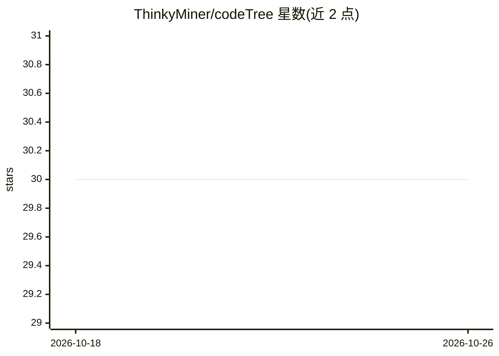

# ThinkyMiner/codeTree

⭐ 30 · Python · MIT · 推送 2026-06-24 · [GitHub](https://github.com/ThinkyMiner/codeTree) · [官网](https://code-tree-website.vercel.app/) · 个人维护

**给编程 Agent 的 MCP 服务器：tree-sitter 结构化代码理解，23 个工具**

面向 Claude Code、Cursor、VS Code Copilot 等 coding agent 的 MCP server，基于 tree-sitter 解析代码，提供文件骨架、符号源码、引用查找、调用图、变更影响分析、圈复杂度、死代码检测、数据流/污点分析、Git 历史分析等 23 个工具，支持 Python/JS/TS/Go/Rust/Java/C/C++/Ruby/Kotlin 等 11 种语言。通过 uvx 一条命令安装，无向量库、无嵌入模型、无配置，SQLite 持久化符号图，启动约 1 秒。面向开发者使用。

## 筛选速览

| 维度 | 判定 | 备注 |
|---|---|---|
| AI 角色 | `ai-ecosystem` | LLM/agent 周边工具 |
| 许可风险 | `permissive` | MIT |
| 部署形态 | `library` | 以包/库形式分发 |
| 模型依赖 | — | README 未给出锁定关系 |
| 硬件要求 | — | 无带数字的原话,不猜 |
| 安装摩擦 | `low` | 无编译、无系统依赖或容器化 |
| 成熟度 | — | 结构信号不足 |

## 能力要点

- 23 个工具覆盖骨架提取、引用/调用图、影响分析、数据流污点追踪
- tree-sitter 解析，支持 11 种语言，每语言一个插件
- uvx 一条命令安装，零配置，~1 秒启动
- compact 输出格式进一步降低 token 消耗

## 适用场景

- 让编程 Agent 以结构化方式理解大型代码库而非读取全文
- 重构前分析变更影响范围与依赖图
- 查找死代码、重复函数与高复杂度热点
- 为符号定位对应测试与生成文档建议

## 场景标签

`代码审查` · 领域:编码与开发

## 证据(README 行号)

> L10: codetree is an MCP server that gives coding agents structured code understanding via tree-sitter — so they ask prec
> L201: Agent (Claude, Copilot, Cursor, etc.)
> L209: |`server.py`|FastMCP server — defines all 23 tools|

## 星数曲线

2026-10-18 30 → 2026-10-26 30（+0）

---
*卡片 v1 · prompt 1.4 · 生成 2026-10-26 · 置信度 high · 依据 README sha `002e8365e5c2` · [字段定义](../../DATASET.md)*
