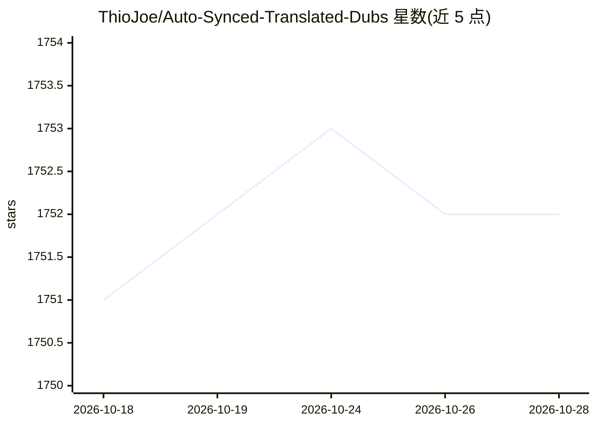

# ThioJoe/Auto-Synced-Translated-Dubs

⭐ 1,752 · Python · AGPL-3.0 · 推送 2026-05-11 · [GitHub](https://github.com/ThioJoe/Auto-Synced-Translated-Dubs) · 组织维护

**基于字幕文件自动翻译配音的 Python 工具，语音与原视频同步**

读取人工制作的 SRT 字幕文件，用 Google Cloud/DeepL 翻译文本生成新字幕，再通过 Azure/Google/ElevenLabs 的神经语音 TTS 合成译文语音，按字幕时间戳拉伸/压缩音频片段并拼装成与原视频同步的配音音轨。附带 TrackAdder（多音轨合入视频）、TitleTranslator、TranscriptAutoSyncUploader 等 YouTube 辅助脚本。需安装 ffmpeg，配置 Google/Azure/DeepL API 密钥后运行 main.py。限制：目前假设单一说话人，需 API 付费服务。

## 筛选速览

| 维度 | 判定 | 备注 |
|---|---|---|
| AI 角色 | `ai-native` | 本体是模型或模型工具 |
| 许可风险 | `viral` | AGPL-3.0 |
| 部署形态 | `desktop` | 安装包/桌面程序 |
| 模型依赖 | — | README 未给出锁定关系 |
| 硬件要求 | — | 无带数字的原话,不猜 |
| 安装摩擦 | `medium` | 含编译或系统依赖之一 |
| 成熟度 | — | 结构信号不足 |

## 能力要点

- 按字幕时间戳计算时长并拉伸/压缩语音片段保持同步
- 支持 3 个 TTS 服务（Azure/Google/ElevenLabs）与 2 个翻译服务（Google/DeepL）
- 可选两遍合成：按第一遍计算的语速重新合成以提升音质（API 费用翻倍）
- 附 YouTube 标题翻译、多音轨合入、字幕上传等辅助脚本

## 适用场景

- 我有现成字幕，想为视频批量生成多语言配音音轨
- YouTube 创作者为视频生成本地化标题、描述与字幕
- 将多语言音轨合入 mp4 后上传 YouTube

## 场景标签

`语音合成` · 领域:内容生成

## 证据(README 行号)

> L2:  Automatically translates the text of a video into chosen languages based on a subtitle file, and also uses AI voice
> L8: 3. Create text-to-speech audio clips of the translated text (using more realistic neural voices)

## 星数曲线

2026-10-18 1,751 → 2026-10-28 1,752（+1）

---
*卡片 v1 · prompt 1.4 · 生成 2026-10-21 · 置信度 mid · 依据 README sha `62137f57604f` · [字段定义](../../DATASET.md)*
