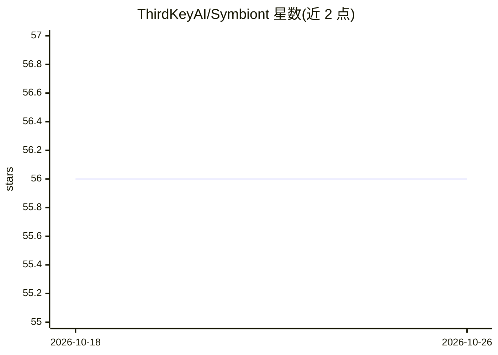

# ThirdKeyAI/Symbiont

⭐ 56 · Rust · Apache-2.0 · 推送 2026-10-24 · [GitHub](https://github.com/ThirdKeyAI/Symbiont) · [官网](https://docs.symbiont.dev) · 组织维护 · 中文 README

**面向生产环境的策略治理型 AI agent 运行时（Rust）**

Rust 编写的 AI agent 与工具执行运行时，核心是把 agent 意图与执行权限分离：内建 DSL 与 Cedar 策略门控、SchemaPin 验证 MCP 工具签名、ToolClad 声明式工具契约、AgentPin ES256 agent 身份、可选 Docker/gVisor/Firecracker 沙箱、Ed25519 签名的哈希链审计日志与人工审批门。它是 Open Agent Trust Stack (OATS) 规范的参考实现。提供 CLI 安装、crates.io 安装、Docker 镜像与源码构建四种途径，支持 OpenAI 兼容接口对接 Ollama 等本地模型；README 注明跨入口点的完全隔离尚未建立。

## 筛选速览

| 维度 | 判定 | 备注 |
|---|---|---|
| AI 角色 | `ai-ecosystem` | LLM/agent 周边工具 |
| 许可风险 | `permissive` | Apache-2.0 |
| 部署形态 | `self-host` | docker 或自建部署 |
| 模型依赖 | local-ok | 支持本地模型 |
| 硬件要求 | — | 无带数字的原话,不猜 |
| 安装摩擦 | `low` | 无编译、无系统依赖或容器化 |
| 成熟度 | `idea` | |

## 能力要点

- Cedar 策略门控在编译期不可跳过，默认 fail-closed
- SchemaPin 加密验证 MCP 工具 + AgentPin 域锚定 ES256 身份
- 哈希链 + Ed25519 签名的防篡改审计日志与人工审批门
- OATS 开放规范的参考实现，支持本地模型运行（无需云 API key）

## 适用场景

- 让 agent 在生产环境执行工具调用时受策略与审批约束
- 对敏感操作留痕审计，满足合规要求
- 在 Docker/gVisor/Firecracker 沙箱中运行高风险 agent 工作负载
- 用本地模型（如 Ollama）离线运行受治理的 agent

## 场景标签

`Agent 框架` `网络安全` · 领域:Agent 开发

## 证据(README 行号)

> L23: Symbiont is a Rust-native runtime for executing AI agents and tools under explicit policy, identity, and audit cont
> L30: Most agent frameworks focus on orchestration. Symbiont focuses on what happens when agents need to run in real envi
> L57: Symbiont is the **reference implementation of the Open Agent Trust Stack (OATS)** — an open specification (CC BY 4.

## 星数曲线

2026-10-18 56 → 2026-10-26 56（+0）

---
*卡片 v1 · prompt 1.4 · 生成 2026-10-24 · 置信度 high · 依据 README sha `04336ead2d41` · [字段定义](../../DATASET.md)*
