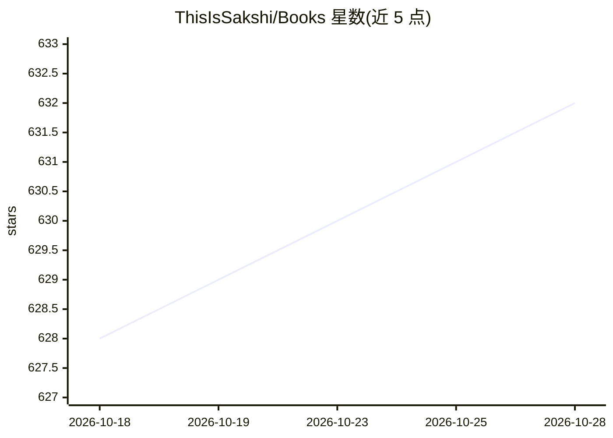

# ThisIsSakshi/Books

⭐ 632 · Python · MIT · 推送 2026-02-16 · [GitHub](https://github.com/ThisIsSakshi/Books) · 个人维护

**免费编程/ML/面试书籍资源汇总清单**

个人维护的免费书籍与学习资源链接清单，按六个板块组织：Python、机器学习与数据科学（约30本，含 Hands-on ML、Deep Learning with Python、Mathematics for ML 等）、系统设计、面试准备（Cracking the Coding Interview、LeetCode 题集等）、其他技术书（Git、SQL、Excel）及个人成长类书籍。README 仅列出书名条目，不提供安装、运行或代码，属于纯静态资源目录。

## 筛选速览

| 维度 | 判定 | 备注 |
|---|---|---|
| AI 角色 | `ai-knowledge` | 知识聚合/清单类 |
| 许可风险 | `permissive` | MIT |
| 部署形态 | `None` |  |
| 模型依赖 | — | README 未给出锁定关系 |
| 硬件要求 | — | 无带数字的原话,不猜 |
| 安装摩擦 | `low` | 无编译、无系统依赖或容器化 |
| 成熟度 | — | 结构信号不足 |

## 能力要点

- 按 Python/机器学习/系统设计/面试等 6 个板块组织的免费书籍清单
- 机器学习与数据科学板块收录约 30 本书目
- 面试准备板块含算法、系统设计与 FAANG 相关资料

## 适用场景

- 寻找机器学习与数据科学的入门书目
- 准备编程面试与系统设计面试时查找资料
- 汇总免费 Python 与技术学习资源

## 场景标签

`精选清单` · 领域:学习与行业

## 证据(README 行号)

> L1: # Books
> L3: ## Few books and resources to read
> L28:  Machine Learning 🤖

## 星数曲线

2026-10-18 628 → 2026-10-28 632（+4）

---
*卡片 v1 · prompt 1.4 · 生成 2026-10-21 · 置信度 high · 依据 README sha `e24512435798` · [字段定义](../../DATASET.md)*
