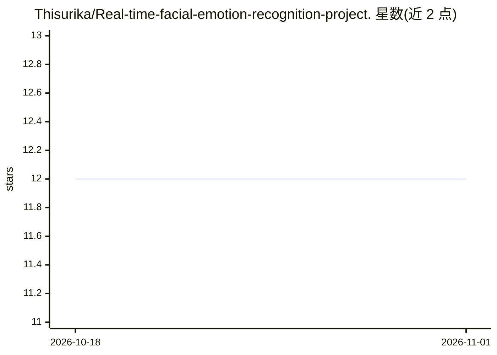

# Thisurika/Real-time-facial-emotion-recognition-project.

⭐ 12 · Jupyter Notebook · 推送 2026-08-13 · [GitHub](https://github.com/Thisurika/Real-time-facial-emotion-recognition-project.) · 个人维护

**CNN 实时识别 7 类人脸表情的检测项目**

基于 Keras/TensorFlow 的卷积神经网络人脸表情识别项目：在 FER-2013 数据集（约 35,887 张 48×48 灰度人脸图）上训练，检测 Angry、Disgust、Fear、Happy、Neutral、Sad、Surprise 共 7 类情绪。模型为 4 个卷积块的 CNN（32→256 滤波器），训练 30 epochs，支持通过 OpenCV 摄像头实时推理或对静态图片检测，输出带边界框与标签的画面。面向学习与实践深度学习表情识别的开发者与学习者。

## 筛选速览

| 维度 | 判定 | 备注 |
|---|---|---|
| AI 角色 | `ai-native` | 本体是模型或模型工具 |
| 许可风险 | `none` | — |
| 部署形态 | `None` |  |
| 模型依赖 | — | README 未给出锁定关系 |
| 硬件要求 | — | 无带数字的原话,不猜 |
| 安装摩擦 | `low` | 无编译、无系统依赖或容器化 |
| 成熟度 | — | 结构信号不足 |

## 能力要点

- 识别 7 类情绪，输出带边界框与标签的实时画面
- FER-2013 数据集训练，48×48 灰度输入，含数据增强
- 支持 webcam 实时推理（test.py）与静态图片测试

## 适用场景

- 用摄像头做实时人脸表情检测的学习/演示项目
- 参考 CNN 架构与数据预处理流程完成表情识别练习
- 在静态图片上测试表情分类效果

## 场景标签

`人脸识别` · 领域:感知与多模态

## 证据(README 行号)

> L3: Real-time facial emotion detection system using a Convolutional Neural Network (CNN) trained on the FER-2013 dataset
> L9: This project implements a facial emotion recognition model using Keras/TensorFlow.

## 星数曲线

2026-10-18 12 → 2026-11-01 12（+0）

---
*卡片 v1 · prompt 1.4 · 生成 2026-11-01 · 置信度 high · 依据 README sha `8c394ee55e7e` · [字段定义](../../DATASET.md)*
