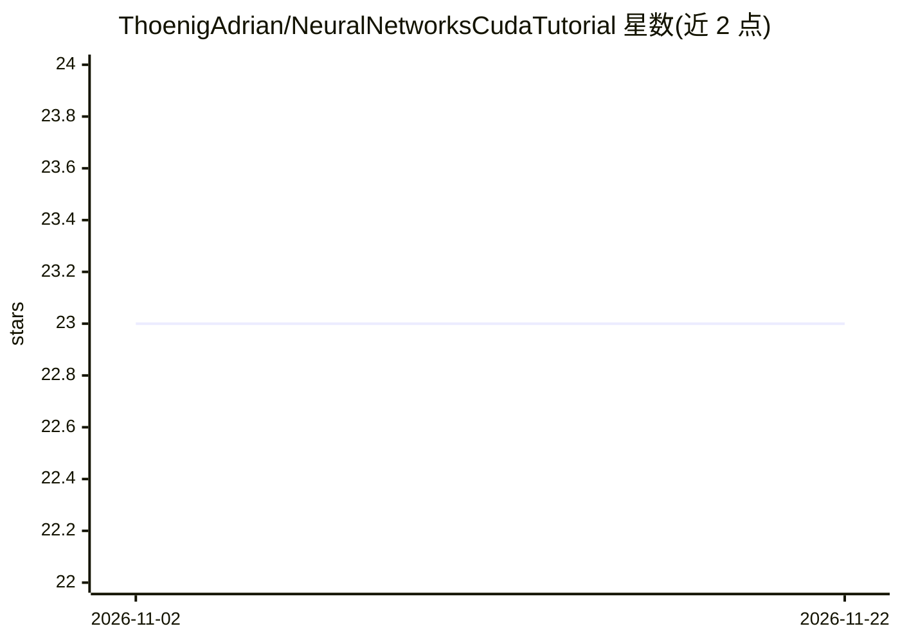

# ThoenigAdrian/NeuralNetworksCudaTutorial

⭐ 23 · Cuda · 推送 2026-11-09 · [GitHub](https://github.com/ThoenigAdrian/NeuralNetworksCudaTutorial) · [官网](https://www.youtube.com/playlist?list=PLdVoL2No_-X9OK8-20KOyVRki5tBMrGGG) · 个人维护

**用 CUDA 从零实现神经网络的系列教程**

多部分教程项目，讲解如何用 CUDA 从零实现神经网络：已覆盖激活函数、线性层、多层前向传播、多输入前向传播与反向传播，梯度下降、训练循环、代价函数与扩展等部分标注为 Planned。教程以 YouTube 视频与 GitHub 文字/代码两种形式提供，README 另附 Windows/Visual Studio 与 Ubuntu 的 CUDA 开发环境搭建指南链接，不提供专门的安装命令。

## 筛选速览

| 维度 | 判定 | 备注 |
|---|---|---|
| AI 角色 | `ai-knowledge` | 知识聚合/清单类 |
| 许可风险 | `none` | — |
| 部署形态 | `None` |  |
| 模型依赖 | — | README 未给出锁定关系 |
| 硬件要求 | — | 无带数字的原话,不猜 |
| 安装摩擦 | `medium` | 含编译或系统依赖之一 |
| 成熟度 | — | 结构信号不足 |

## 能力要点

- 覆盖激活函数、线性层、多层/多输入前向传播与反向传播
- 视频（YouTube）与文字/代码（GitHub）双形式
- 附 Windows 与 Ubuntu 的 CUDA 开发环境搭建指南链接

## 适用场景

- 学习用 CUDA 手写神经网络各组件
- 参照教程实现自己的 CUDA 神经网络内核
- 了解 CUDA 机器学习开发环境搭建路径

## 场景标签

`教程课程` · 领域:学习与行业

## 证据(README 行号)

> L3: This is a multi-part tutorial on how to implement neural networks in CUDA.
> L9: |Part|Topic|Code|Video|

## 星数曲线

2026-11-02 23 → 2026-11-22 23（+0）

---
*卡片 v1 · prompt 1.4 · 生成 2026-11-18 · 置信度 high · 依据 README sha `a26d36a04513` · [字段定义](../../DATASET.md)*
