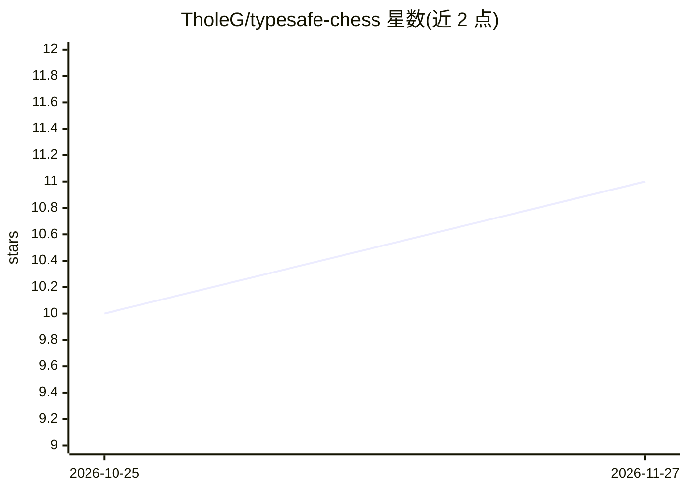

# TholeG/typesafe-chess

⭐ 11 · JavaScript · MIT · 推送 2026-10-29 · [GitHub](https://github.com/TholeG/typesafe-chess) · 个人维护

**让两个 Jev 模型对弈国际象棋的演示项目**

两个虚拟棋手均由 TypeSafe 的 System One 模型 Jev 驱动，每步走子以类型化 Choice 问题返回完整概率分布，规则由 chess.js 把控，非法走子被结构性排除；可选 MCTS 模式将同一调用的分布用作 AlphaZero 式搜索的 policy 与 value。前端为 React 棋盘 UI，展示候选箭头、评估条与逐项分析。需 Node.js 20+ 与 TypeSafe API key，密钥保留在服务端。README 附带以 Stockfish 为参照的 regret/match/elo 基准脚本。

## 筛选速览

| 维度 | 判定 | 备注 |
|---|---|---|
| AI 角色 | `ai-native` | 本体是模型或模型工具 |
| 许可风险 | `permissive` | MIT |
| 部署形态 | `library` | 以包/库形式分发 |
| 模型依赖 | — | README 未给出锁定关系 |
| 硬件要求 | — | 无带数字的原话,不猜 |
| 安装摩擦 | `low` | 无编译、无系统依赖或容器化 |
| 成熟度 | — | 结构信号不足 |

## 能力要点

- 每步走子为类型化 Choice 决策，返回所有合法走法的概率分布
- MCTS 模式将 Jev 分布用作 policy/value，含 PUCT 选择与置换缓存
- Choice/Score/Noul 三类问题合并为一次并行请求
- 提供基于 Stockfish WASM 的 regret、match、elo 基准脚本

## 适用场景

- 观察两个模型棋手完整对弈并查看逐步分析
- 研究类型化模型调用替代自由文本解析的做法
- 以 Stockfish 为参照测量模型棋手的每步损失与 Elo 估计

## 场景标签

`模型评测` · 领域:评测与运维

## 证据(README 行号)

> L3: Two virtual chess players, both powered by **TypeSafe**'s System One model **Jev**.
> L4: No engine, no generated text: each move is a typed decision that the model returns with a full
> L93: Requires Node.js 20+ and a TypeSafe API key (get one at typesafe.ai).

## 星数曲线

2026-10-25 10 → 2026-11-27 11（+1）

---
*卡片 v1 · prompt 1.4 · 生成 2026-11-20 · 置信度 high · 依据 README sha `c69bda5a3979` · [字段定义](../../DATASET.md)*
