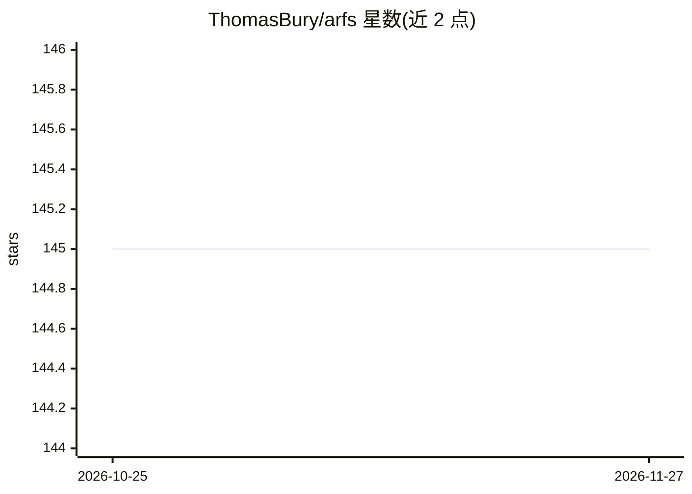

# ThomasBury/arfs

⭐ 145 · Python · MIT · 推送 2026-11-19 · [GitHub](https://github.com/ThomasBury/arfs) · 个人维护

**给数据科学者做全相关特征选择的 Python 库**

提供 All Relevant Feature Selection 方法的 Python 库，实现 Leshy、BoostAGroota、GrootCV 等选择器：GrootCV 通过 LightGBM 将各预测变量重要性与其打乱副本对比来筛选特征，另支持 MRMR、Lasso、离散化与自分箱等流程。面向需要回归/分类特征选择的机器学习从业者，通过 PyPI 安装，提供入门示例与回归分类、时间序列、Poisson 损失等教程文档，选择结果依赖数据、模型与训练划分。

## 筛选速览

| 维度 | 判定 | 备注 |
|---|---|---|
| AI 角色 | `ai-native` | 本体是模型或模型工具 |
| 许可风险 | `permissive` | MIT |
| 部署形态 | `library` | 以包/库形式分发 |
| 模型依赖 | — | README 未给出锁定关系 |
| 硬件要求 | — | 无带数字的原话,不猜 |
| 安装摩擦 | `low` | 无编译、无系统依赖或容器化 |
| 成熟度 | — | 结构信号不足 |

## 能力要点

- Leshy、BoostAGroota、GrootCV 等 all-relevant 选择方法
- GrootCV 基于 LightGBM SHAP 贡献跨折对比打乱副本
- 支持 MRMR、Lasso、关联分析与离散化预处理
- 提供 PyPI 安装与方法选择指南

## 适用场景

- 回归/分类建模前筛选全相关特征
- 处理类别型预测变量与共线性筛选
- 时间序列场景下做特征选择与行采样评估

## 场景标签

 · 领域:机器学习/特征工程

## 证据(README 行号)

> L1: # ARFS feature selection
> L43: GrootCV uses LightGBM to compare each predictor's importance with shuffled

## 星数曲线

2026-10-25 145 → 2026-11-27 145（+0）

---
*卡片 v1 · prompt 1.4 · 生成 2026-11-27 · 置信度 high · 依据 README sha `9c8118fd10cf` · [字段定义](../../DATASET.md)*
