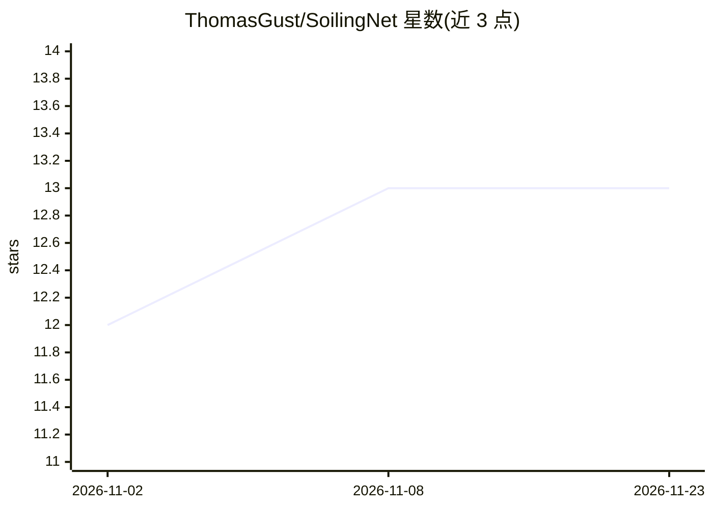

# ThomasGust/SoilingNet

⭐ 13 · Python · MIT · 推送 2026-11-02 · [GitHub](https://github.com/ThomasGust/SoilingNet) · 个人维护

**分析光伏面板积灰与功率损失的 AI 模型项目**

研究性质项目：从一张面板照片加上辐照度读数，输出积灰位置的分割掩码（8 类）与功率损失严重度分级。作者手工标注 184 张 DeepSolarEye 图像并扩充到 1,104 对图像-掩码；分割部分训练并对比 FCN-32、U-Net、SegNet 三种架构，分类部分为接收 4 通道输入的 PyTorch CNN。提供预训练权重文件与训练代码，项目写成论文；作者在 README 中说明评估方法存在缺陷、指标偏乐观。未提供安装说明。

## 筛选速览

| 维度 | 判定 | 备注 |
|---|---|---|
| AI 角色 | `ai-native` | 本体是模型或模型工具 |
| 许可风险 | `permissive` | MIT |
| 部署形态 | `None` |  |
| 模型依赖 | — | README 未给出锁定关系 |
| 硬件要求 | — | 无带数字的原话,不猜 |
| 安装摩擦 | `low` | 无编译、无系统依赖或容器化 |
| 成熟度 | — | 结构信号不足 |

## 能力要点

- 8 类积灰分割掩码输出（含鸟粪、雪等六种积灰类型）
- 分割对比 FCN-32、U-Net(ResNet-50)、SegNet(ResNet-50) 三种架构
- 功率损失按 4/8/12/16 档严重度分类，最大输入为图像+掩码+辐照度
- 提供分割与分类的预训练权重文件

## 适用场景

- 对光伏面板照片做积灰区域分割
- 结合辐照度读数估计积灰导致的功率损失档位
- 作为太阳能电站按需清洗决策的参考研究

## 场景标签

`目标检测` · 领域:感知与多模态

## 证据(README 行号)

> L3: SoilingNet analyzes dirt and debris ("soiling") on solar panels. From one photo of a panel and a solar irradiance re
> L17: **Soiling segmentation.** I trained and compared three segmentation architectures: FCN-32, U-Net with a ResNet-50 e
> L19: **Power-loss classification.** DeepSolarEye records power loss as a continuous value, which I split into 4, 8, 12, 

## 星数曲线

2026-11-02 12 → 2026-11-23 13（+1）

---
*卡片 v1 · prompt 1.4 · 生成 2026-11-18 · 置信度 high · 依据 README sha `33debecb969d` · [字段定义](../../DATASET.md)*
