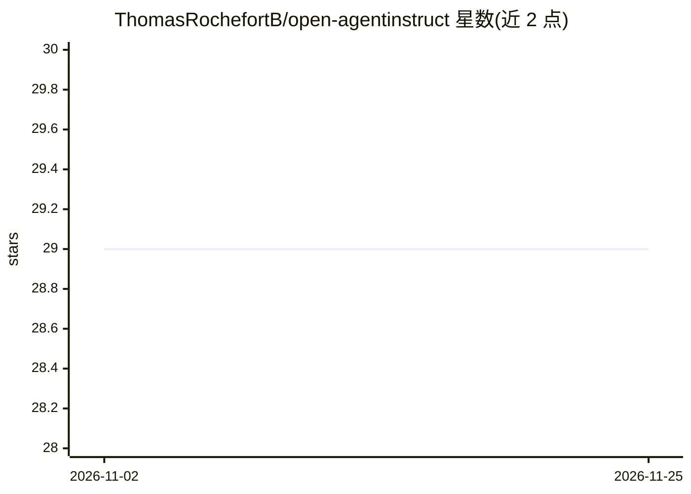

# ThomasRochefortB/open-agentinstruct

⭐ 29 · Python · MIT · 推送 2026-11-23 · [GitHub](https://github.com/ThomasRochefortB/open-agentinstruct) · 个人维护

**开源复刻 AgentInstruct 的合成数据生成工作流，供开发者生成微调数据**

复刻 AgentInstruct 论文的 agentic 合成数据生成工作流：基于种子数据（HF 数据集或用户 PDF）经内容变换、指令生成、指令精炼三个 agentic 步骤生成指令数据，覆盖阅读理解、问答、编程等 17 类任务。支持任何 LiteLLM 兼容模型，需配置 API key；通过 pip 或源码安装，CLI 命令生成 JSONL 数据。要求 Python 3.11–3.14，PyPI 发布处于受阻状态（0.1.0 后待 trusted-publisher 验证）。

## 筛选速览

| 维度 | 判定 | 备注 |
|---|---|---|
| AI 角色 | `ai-ecosystem` | LLM/agent 周边工具 |
| 许可风险 | `permissive` | MIT |
| 部署形态 | `library` | 以包/库形式分发 |
| 模型依赖 | — | README 未给出锁定关系 |
| 硬件要求 | — | 无带数字的原话,不猜 |
| 安装摩擦 | `low` | 无编译、无系统依赖或容器化 |
| 成熟度 | — | 结构信号不足 |

## 能力要点

- 三步 agentic 流程：内容变换→指令生成→指令精炼
- 实现 AgentInstruct 论文全部 17 类任务
- 支持任意 LiteLLM 兼容模型与 HF 数据集/用户 PDF 种子
- CLI 生成 JSONL 格式训练数据

## 适用场景

- 用自有 PDF 或 HF 数据集生成指令微调数据
- 复现 AgentInstruct 论文的合成数据流程
- 为多种任务类型批量生成训练语料

## 场景标签

`微调` · 领域:训练与推理

## 证据(README 行号)

> L6: `open-agentinstruct` is a project aimed at recreating the AgentInstruct agentic workflow. It supports any LiteLLM mo
> L13: ## Supported tasks

## 星数曲线

2026-11-02 29 → 2026-11-25 29（+0）

---
*卡片 v1 · prompt 1.4 · 生成 2026-11-18 · 置信度 high · 依据 README sha `42dde6da60d3` · [字段定义](../../DATASET.md)*
