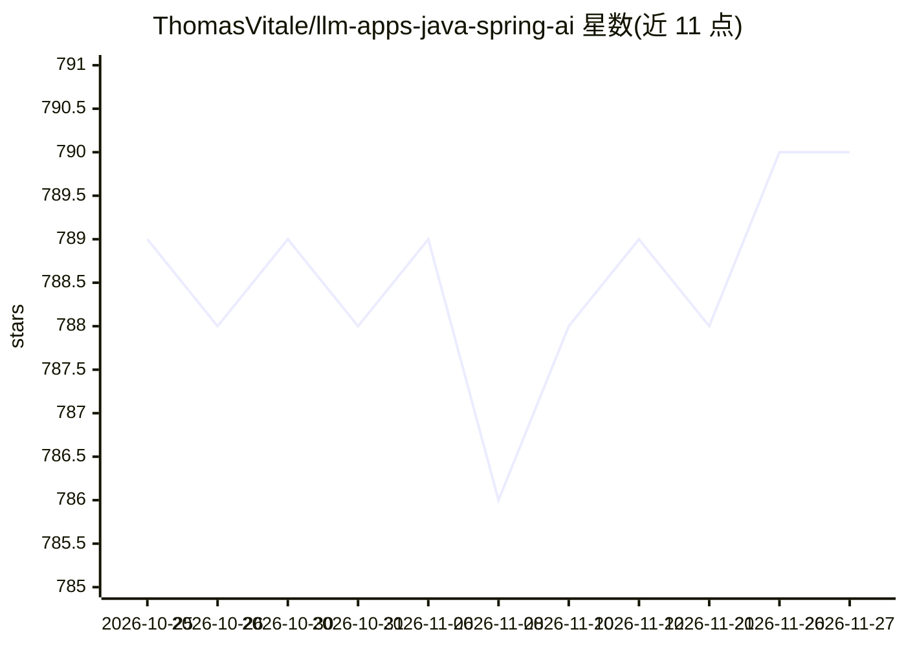

# ThomasVitale/llm-apps-java-spring-ai

⭐ 790 · Java · Apache-2.0 · 推送 2026-11-22 · [GitHub](https://github.com/ThomasVitale/llm-apps-java-spring-ai) · 个人维护

**Java 开发者用 Spring AI 构建 LLM 应用的示例集**

面向 Java 开发者的示例工程集，演示如何基于 Spring AI 与 Spring Boot 构建 Generative AI 应用。覆盖聊天机器人、文档问答（RAG）、语义搜索、结构化数据抽取、文本分类等用例，并按 Chat/Embedding/Image/Audio 模型、提示模板、结构化输出、工具调用、记忆、Guardrails、MCP、可观测性等主题组织代码示例。要求 Java 25 与 Podman/Docker；评测、Agent、向量存储等章节标注为即将推出。

## 筛选速览

| 维度 | 判定 | 备注 |
|---|---|---|
| AI 角色 | `ai-knowledge` | 知识聚合/清单类 |
| 许可风险 | `permissive` | Apache-2.0 |
| 部署形态 | `None` |  |
| 模型依赖 | local-ok | 支持本地模型 |
| 硬件要求 | — | 无带数字的原话,不猜 |
| 安装摩擦 | `medium` | 含编译或系统依赖之一 |
| 成熟度 | — | 结构信号不足 |

## 能力要点

- 按模型类型与模式组织的 Spring AI 示例集（提示、结构化输出、工具调用、记忆、Guardrails）
- RAG 示例覆盖顺序、分支、条件三种流程（Ollama + PGVector）
- 覆盖 Chat/Embedding/Image/Audio 模型及多提供商接入
- 包含 LLM 与向量存储可观测性、MCP 服务器集成示例

## 适用场景

- 学习如何在 Java/Spring Boot 中接入 LLM 构建应用
- 参考实现聊天机器人、RAG 问答与语义搜索
- 按示例接入 Ollama、OpenAI、Mistral AI 等多种模型提供商
- 了解 Spring AI 的工具调用、记忆与可观测性用法

## 场景标签

`聊天机器人` `RAG` `文档问答` `语义搜索` · 领域:对话与助手

## 证据(README 行号)

> L3: Samples showing how to build Java applications powered by Generative AI and Large Language Models (LLMs) using Sprin
> L10: ## 💡 Use Cases
> L27: ## 🧠 Models

## 星数曲线

2026-10-25 789 → 2026-11-27 790（+1）

---
*卡片 v1 · prompt 1.4 · 生成 2026-11-24 · 置信度 high · 依据 README sha `84b8ceb14c1a` · [字段定义](../../DATASET.md)*
