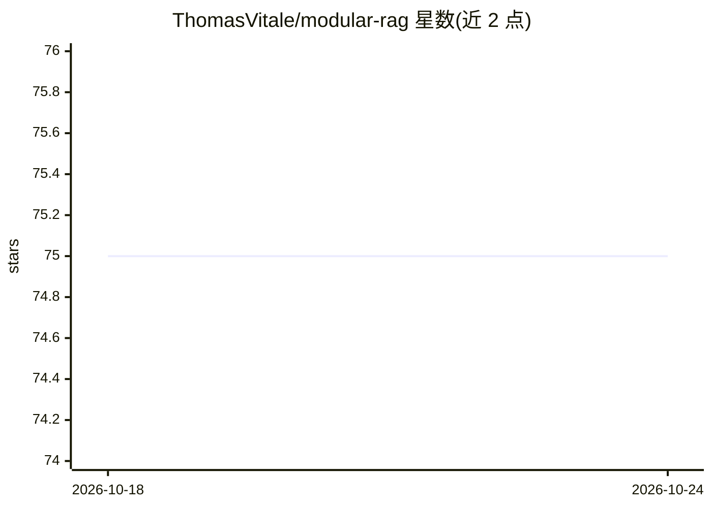

# ThomasVitale/modular-rag

⭐ 75 · Java · Apache-2.0 · 推送 2026-10-22 · [GitHub](https://github.com/ThomasVitale/modular-rag) · 个人维护

**用 Spring AI 和 Ollama 演示模块化 RAG 架构模式的示例集**

面向 Java 开发者的示例工程集合：基于 Spring AI 构建模块化 RAG 应用，模型推理由 Ollama 提供（可本地运行或由 Arconia Dev Services 经 Testcontainers 自动拉起），Spring AI 启动时自动拉取缺失模型。可选接入 Tavily Search API 作为检索来源，需自备 API key。运行时通过 Arconia 自动启动 PostgreSQL、Grafana LGTM/Arize Phoenix 可观测平台与 Docling Serve；应用提供 Gradle 运行方式并在 8080 端口访问。前置要求 Java 25 与 Podman/Docker。

## 筛选速览

| 维度 | 判定 | 备注 |
|---|---|---|
| AI 角色 | `ai-ecosystem` | LLM/agent 周边工具 |
| 许可风险 | `permissive` | Apache-2.0 |
| 部署形态 | `None` |  |
| 模型依赖 | local-ok | 支持本地模型 |
| 硬件要求 | — | 无带数字的原话,不猜 |
| 安装摩擦 | `medium` | 含编译或系统依赖之一 |
| 成熟度 | — | 结构信号不足 |

## 能力要点

- Spring AI + Ollama 的模块化 RAG 架构模式示例
- Arconia Dev Services 自动拉起 PostgreSQL、可观测平台与 Ollama 服务
- 可选 Tavily Search API 作为检索数据源
- 日志/指标/追踪经 OTLP 导出到 Grafana

## 适用场景

- 学习如何在 Java/Spring 技术栈中搭建模块化 RAG 应用
- 参考 Ollama 本地模型与 Dev Services 的集成方式
- 了解 RAG 应用结合 Grafana/Phoenix 的可观测性配置

## 场景标签

`RAG` · 领域:知识与检索

## 证据(README 行号)

> L3: Samples showing architectural patterns for Modular RAG using Spring AI and Ollama.
> L12: The application consumes models from an Ollama inference server. You can either run Ollama locally on your laptop, 
> L44: Under the hood, the Arconia framework will automatically spin up a PostgreSQL database, a Grafana LGTM or Arize Pho

## 星数曲线

2026-10-18 75 → 2026-10-24 75（+0）

---
*卡片 v1 · prompt 1.4 · 生成 2026-10-24 · 置信度 high · 依据 README sha `5459ccbd1fcb` · [字段定义](../../DATASET.md)*
