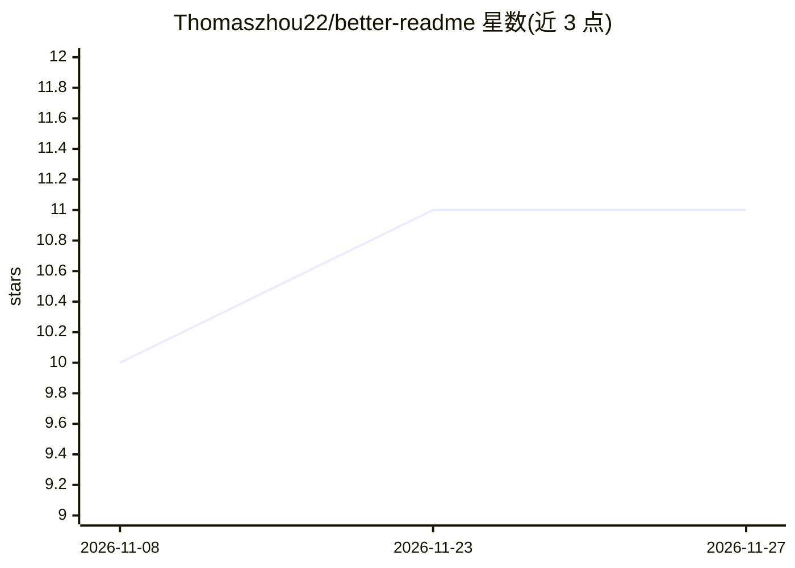

# Thomaszhou22/better-readme

⭐ 11 · Python · MIT · 推送 2026-11-23 · [GitHub](https://github.com/Thomaszhou22/better-readme) · 个人维护 · 中文 README

**给项目 README 打分、生成与优化的 AI agent 技能**

以 SKILL.md 格式发布的 agent 技能，面向使用 AI 编码助手的开发者：先自动识别项目类型（库、CLI、应用、agent 技能、数据集），按 9 个维度对现有 README 打百分制分数，再基于匹配模板并扫描项目真实数据生成无占位符的英文 README，可按需生成其他语言版本；另提供首次使用的 onboarding（批量审计已有仓库）与发布前检查清单。核心为 Python 脚本实现，无第三方依赖，需 Python 3.8+。

## 筛选速览

| 维度 | 判定 | 备注 |
|---|---|---|
| AI 角色 | `ai-native` | 本体是模型或模型工具 |
| 许可风险 | `none` | MIT |
| 部署形态 | `library` | 以包/库形式分发 |
| 模型依赖 | — | README 未给出锁定关系 |
| 硬件要求 | — | 无带数字的原话,不猜 |
| 安装摩擦 | `low` | 无编译、无系统依赖或容器化 |
| 成熟度 | — | 结构信号不足 |

## 能力要点

- 9 维度 100 分制 README 评分体系
- 按 5 种项目类型匹配对应模板（API-first/Demo-first 等）
- 扫描代码库真实数据填充模板，不生成占位文本
- 0 第三方依赖，仅需 Python 3.8+

## 适用场景

- 给自己仓库的 README 做质量评分并找出薄弱项
- 让 AI agent 一键为新项目生成规范的双语 README
- 发布前按清单检查文档完整性

## 场景标签

`AI 写作` · 领域:内容生成

## 证据(README 行号)

> L11: Audit, generate, and optimize project README files with quality scoring, template matching, and multilingual suppor
> L41: Or just tell your AI agent: **"Check my README"** — it'll handle the rest.
> L143: - ✅ OpenClaw

## 星数曲线

2026-11-08 10 → 2026-11-27 11（+1）

---
*卡片 v1 · prompt 1.4 · 生成 2026-11-20 · 置信度 mid · 依据 README sha `38b0c8139b40` · [字段定义](../../DATASET.md)*
