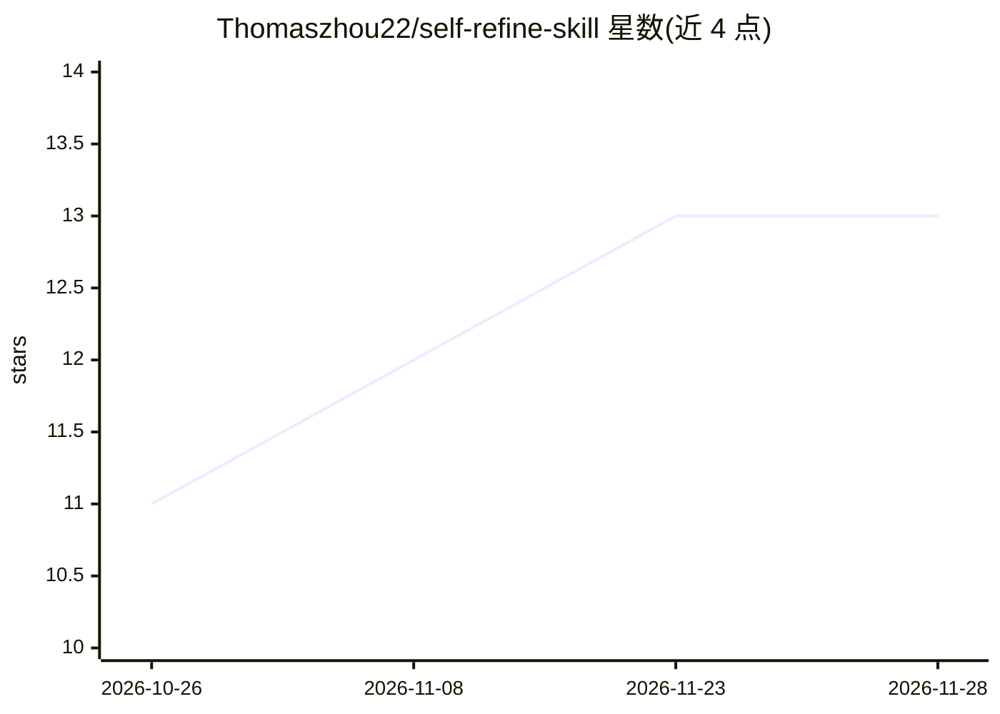

# Thomaszhou22/self-refine-skill

⭐ 13 · MIT · 推送 2026-11-15 · [GitHub](https://github.com/Thomaszhou22/self-refine-skill) · 个人维护 · 中文 README

**为 AI agent 提供系统性自我反思流程的 SKILL.md 技能文件**

单文件（SKILL.md）形式的 agent 技能，为宿主 AI 增加生成前自审步骤：GENERATE→CRITIQUE→REFINE→CHECK 循环，由宿主模型自任评审者。内置 6 个反思维度（逻辑完整性、事实准确性、简洁性等）与 4 档自动选择的反思深度，并提供跨会话记忆机制记录重复错误模式。无依赖、不产生额外 API 调用，通过复制文件并加入各平台的指令文件（CLAUDE.md、.cursorrules、AGENTS.md 等）接入。

## 筛选速览

| 维度 | 判定 | 备注 |
|---|---|---|
| AI 角色 | `ai-knowledge` | 知识聚合/清单类 |
| 许可风险 | `permissive` | MIT |
| 部署形态 | `library` | 以包/库形式分发 |
| 模型依赖 | — | README 未给出锁定关系 |
| 硬件要求 | — | 无带数字的原话,不猜 |
| 安装摩擦 | `low` | 无编译、无系统依赖或容器化 |
| 成熟度 | — | 结构信号不足 |

## 能力要点

- 单文件技能，无依赖、无额外 API 成本
- 6 个反思维度 × 4 档自动选择的反思深度
- Reflexion 式跨会话错误记忆
- 声明覆盖 14 个 agent 平台的接入方式

## 适用场景

- 给编码 agent 加上输出前自审流程
- 在 Cursor/Copilot 等 IDE 中降低回答冗余与逻辑断裂
- 让 agent 在多轮会话中避免重复犯错

## 场景标签

`提示工程` · 领域:Agent 开发

## 证据(README 行号)

> L3: **Systematic self-reflection for AI agents.**
> L26: GENERATE → CRITIQUE → REFINE → CHECK → DELIVER

## 星数曲线

2026-10-26 11 → 2026-11-28 13（+2）

---
*卡片 v1 · prompt 1.4 · 生成 2026-11-18 · 置信度 mid · 依据 README sha `0b421d784b5b` · [字段定义](../../DATASET.md)*
