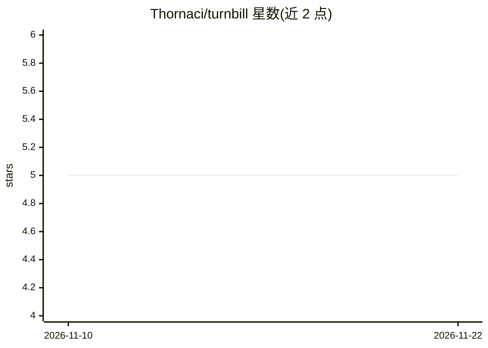

# Thornaci/turnbill

⭐ 5 · TypeScript · MIT · 推送 2026-11-09 · [GitHub](https://github.com/Thornaci/turnbill) · 个人维护

**为 Claude Code 用户本地产出逐条提示词的成本仪表盘**

本地运行的仪表盘：读取 Claude Code 在用户机器上保留的转录文件，按 Anthropic API 牌价逐条计算每个提示词、每次 API 调用的费用，按缓存读/写、输入、输出分项展示，并标记缓存重建、压缩、子代理运行等费用成因。提供项目/会话/提示词三层视图、浪费启发式分析、CSV/JSON 导出与定价方法说明页。需 Node.js 20+，服务器仅监听 127.0.0.1，数据不上传；准确度上与 Claude Code 自身计数器对比约为 89%，部分计费请求不出现在转录中。

## 筛选速览

| 维度 | 判定 | 备注 |
|---|---|---|
| AI 角色 | `ai-ecosystem` | LLM/agent 周边工具 |
| 许可风险 | `permissive` | MIT |
| 部署形态 | `library` | 以包/库形式分发 |
| 模型依赖 | — | README 未给出锁定关系 |
| 硬件要求 | — | 无带数字的原话,不猜 |
| 安装摩擦 | `low` | 无编译、无系统依赖或容器化 |
| 成熟度 | — | 结构信号不足 |

## 能力要点

- 读取本地 Claude Code 转录并按 API 牌价逐提示词计费
- 解释费用成因：缓存重建、大上下文、大工具输出、子代理占比等
- 提供 npm run calibrate 与 Claude Code 自身计数器交叉核对
- 仅监听 127.0.0.1，转录只读不上传

## 适用场景

- 查看我每个 Claude Code 提示词花了多少钱、贵在哪里
- 比较订阅计划费用与 API 等价支出的差异
- 把会话费用审查文本贴给助手分析优化空间

## 场景标签

`LLM 可观测性` · 领域:评测与运维

## 证据(README 行号)

> L5: See what your Claude Code usage costs, down to every prompt and API call. Turnbill reads the transcripts Claude Code
> L17: Then open http://localhost:4317. Requires Node.js 20 or later. Nothing is uploaded: the server only listens on `127

## 星数曲线

2026-11-10 5 → 2026-11-22 5（+0）

---
*卡片 v1 · prompt 1.4 · 生成 2026-11-21 · 置信度 high · 依据 README sha `7553547875b9` · [字段定义](../../DATASET.md)*
