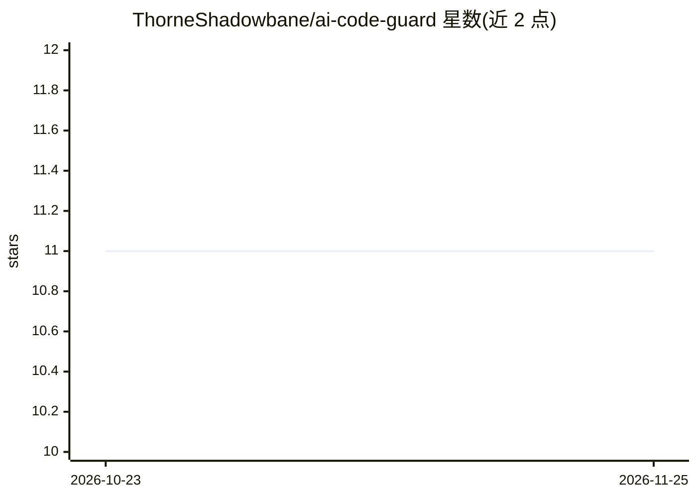

# ThorneShadowbane/ai-code-guard

⭐ 11 · Python · MIT · 推送 2026-01-16 · [GitHub](https://github.com/ThorneShadowbane/ai-code-guard) · 个人维护

**扫描 AI 生成 Python 代码安全漏洞的 CLI 安全扫描器**

面向 Python 代码的静态安全扫描器，定位为检测 AI 编程助手生成代码中的漏洞。机制上基于 AST 解析、污点追踪与 Shannon 熵进行密钥检测，覆盖注入、反序列化、SSRF、提示注入（直接/间接）与供应链（typosquatting、依赖混淆）等类别，规则以 SEC/INJ/PRI 等编号组织。输出支持 Console、JSON、SARIF、Markdown，提供 GitHub Actions、GitLab CI 与 pre-commit 集成配置示例。安装通过 pip，需要 Python 3.10+。

## 筛选速览

| 维度 | 判定 | 备注 |
|---|---|---|
| AI 角色 | `ai-native` | 本体是模型或模型工具 |
| 许可风险 | `permissive` | MIT |
| 部署形态 | `library` | 以包/库形式分发 |
| 模型依赖 | — | README 未给出锁定关系 |
| 硬件要求 | — | 无带数字的原话,不猜 |
| 安装摩擦 | `low` | 无编译、无系统依赖或容器化 |
| 成熟度 | — | 结构信号不足 |

## 能力要点

- 基于 AST 解析与污点追踪的分析方式
- Shannon 熵区分真实密钥与占位符
- 直接与间接提示注入检测（PRI 规则组）
- SARIF 输出配合 GitHub Security 与 CI/CD 集成

## 适用场景

- 在 CI 流水线中扫描 AI 助手生成代码的安全漏洞
- 提交前用 pre-commit 钩子检查硬编码密钥
- 审计 LLM/RAG 应用代码中的提示注入风险

## 场景标签

`网络安全` · 领域:学习与行业

## 证据(README 行号)

> L8: > **Industry-grade security scanner for AI-generated code** with AST analysis, taint tracking, and LLM-specific vuln
> L10: AI coding assistants (GitHub Copilot, Claude, ChatGPT, Cursor) are revolutionizing development—but they can introdu
> L51: pip install ai-code-guard

## 星数曲线

2026-10-23 11 → 2026-11-25 11（+0）

---
*卡片 v1 · prompt 1.4 · 生成 2026-11-19 · 置信度 high · 依据 README sha `99a2919d2928` · [字段定义](../../DATASET.md)*
