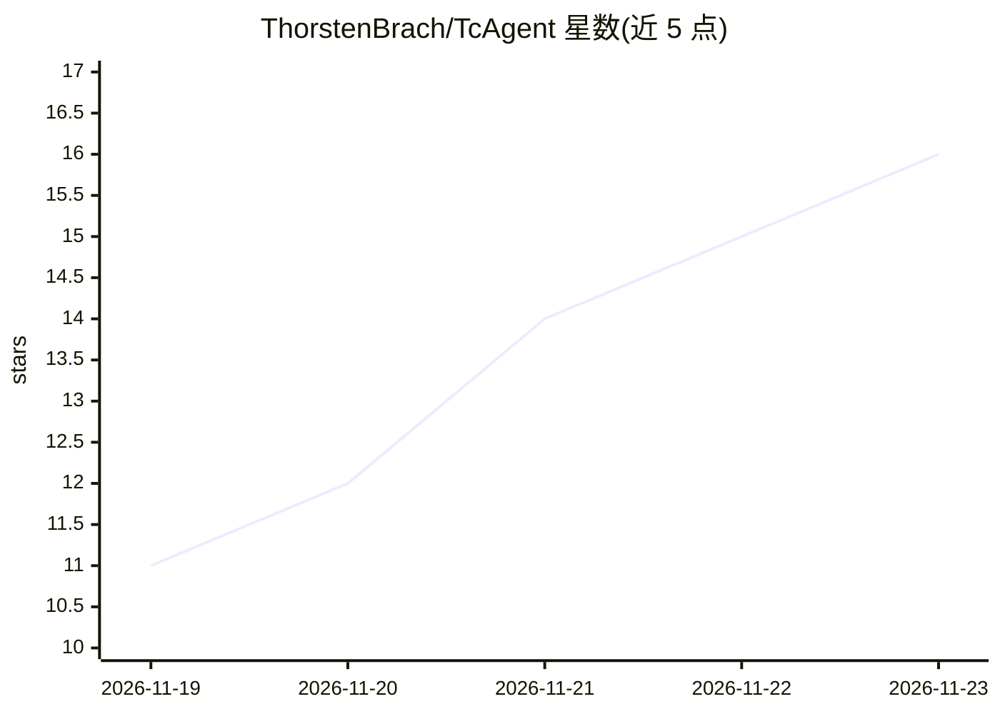

# ThorstenBrach/TcAgent

⭐ 16 · C# · MIT · 推送 2026-11-18 · [GitHub](https://github.com/ThorstenBrach/TcAgent) · 个人维护

**让 AI 编码代理操作 TwinCAT 3 IDE 的 MCP 服务器与 VS 扩展**

以 MCP 服务器和 Visual Studio 扩展两种形式提供，将正在运行的 TwinCAT 3 IDE 暴露为一组工具（tc_*），供 Claude、GitHub Copilot、Gemini、ChatGPT/Codex 等代理读写 PLC 代码、检查构建、导航、查库 API、配置 I/O 与任务、控制运行时。提供七步工作流（理解/计划/实现/构建/测试/评审/部署）并在计划、构建、部署处强制检查点；部署须通过干净构建、允许目标与用户确认。附 Advisor 只读诊断模块与无 AI 的 CI 管道用法。

## 筛选速览

| 维度 | 判定 | 备注 |
|---|---|---|
| AI 角色 | `ai-ecosystem` | LLM/agent 周边工具 |
| 许可风险 | `permissive` | MIT |
| 部署形态 | `desktop` | 安装包/桌面程序 |
| 模型依赖 | — | README 未给出锁定关系 |
| 硬件要求 | — | 无带数字的原话,不猜 |
| 安装摩擦 | `medium` | 含编译或系统依赖之一 |
| 成熟度 | — | 结构信号不足 |

## 能力要点

- MCP 服务器将 TwinCAT IDE 能力以 tc_* 工具集暴露给 AI 代理
- 七步工作流带强制检查点：确认规格后才写码、干净构建后才激活
- PLC 代码可导出为 .st 纯文本供评审、Git diff 与批量编辑
- Advisor 模块在开发/调试/运行三阶段只读诊断，不改项目

## 适用场景

- 让 AI 编码代理在 TwinCAT 工程中生成并验证 PLC 代码
- 在 CI 管道中无 AI 地执行构建、测试与库版本锁定
- 调试运行中的产线故障并获取带证据的诊断建议

## 场景标签

`编码 Agent` · 领域:编码与开发

## 证据(README 行号)

> L3:  TcAgent – TwinCAT 3 for AI coding agents
> L5: Let Claude, GitHub Copilot, Gemini or ChatGPT/Codex work inside your running TwinCAT 3 IDE :
> L11: MCP

## 星数曲线

2026-11-19 11 → 2026-11-23 16（+5）

---
*卡片 v1 · prompt 1.4 · 生成 2026-11-19 · 置信度 mid · 依据 README sha `e0c8f89fb999` · [字段定义](../../DATASET.md)*
