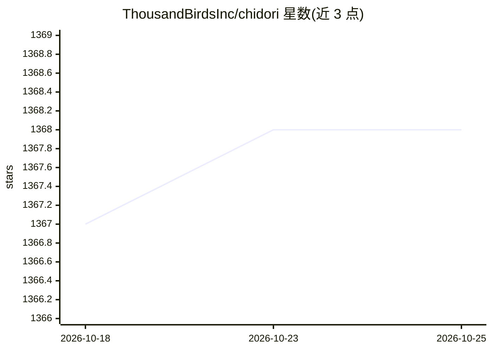

# ThousandBirdsInc/chidori

⭐ 1,368 · Rust · Apache-2.0 · 推送 2026-10-22 · [GitHub](https://github.com/ThousandBirdsInc/chidori) · [官网](https://thousandbirdsinc.github.io/chidori/) · 组织维护

**默认可持久化、可重放、可恢复的 TypeScript agent 运行时框架**

用普通 async/await TypeScript 编写 agent，由一个自包含的 Rust 二进制运行时执行：所有 LLM 调用、工具调用与 HTTP 请求都作为被记录的 host call 经过运行时，因此任意一次运行都可落盘 checkpoint、零 LLM 调用地按字节重放、崩溃后在新进程中恢复，或挂起等待人工输入后继续。内嵌纯 Rust JavaScript 引擎，无需 Node/Deno，提供 TypeScript 与 Python SDK（可选）。默认运行时对工具调用、网络与写盘要求终端按键批准，CI 等场景需 --trusted。

## 筛选速览

| 维度 | 判定 | 备注 |
|---|---|---|
| AI 角色 | `ai-ecosystem` | LLM/agent 周边工具 |
| 许可风险 | `permissive` | Apache-2.0 |
| 部署形态 | `desktop` | 安装包/桌面程序 |
| 模型依赖 | local-ok | 支持本地模型 |
| 硬件要求 | — | 无带数字的原话,不猜 |
| 安装摩擦 | `medium` | 含编译或系统依赖之一 |
| 成熟度 | — | 结构信号不足 |

## 能力要点

- 所有副作用作为 recorded host call，运行可 checkpoint/重放/恢复
- 重放零 LLM 调用且字节级一致（固定时钟、种子随机）
- 单个 Rust 二进制 + 内嵌纯 Rust JS 引擎，无 Node、无原生绑定
- 默认对工具调用/网络/写盘做审批门控，--trusted 可跳过

## 适用场景

- 构建崩溃后可从中断点恢复的长时间运行 agent
- 把录制的运行提交到 git 作为零成本集成测试
- 让多步 agent 挂起等待人工审批数小时后再继续
- 对 agent 运行做免 token 消耗的调试复现

## 场景标签

`Agent 框架` `LLM 可观测性` · 领域:Agent 开发

## 证据(README 行号)

> L7:  Write agents as plain async TypeScript. Every side effect — every LLM call, tool call, and
> L39: The trick is a single boundary. Every side effect an agent performs — every LLM
> L92: Chidori is **one self-contained binary** — the runtime that runs your agents.

## 星数曲线

2026-10-18 1,367 → 2026-10-25 1,368（+1）

---
*卡片 v1 · prompt 1.4 · 生成 2026-10-21 · 置信度 mid · 依据 README sha `e8cb778d4740` · [字段定义](../../DATASET.md)*
