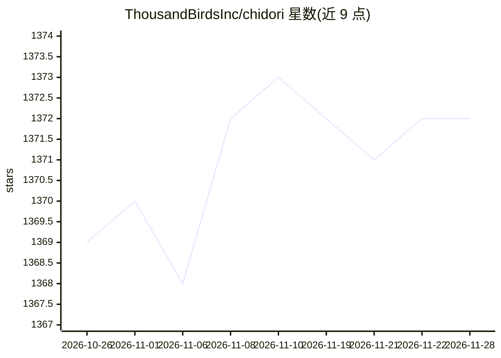

# ThousandBirdsInc/chidori

⭐ 1,372 · Rust · Apache-2.0 · 推送 2026-11-16 · [GitHub](https://github.com/ThousandBirdsInc/chidori) · [官网](https://thousandbirdsinc.github.io/chidori/) · 组织维护

**面向开发者的可持久化、可回放、可恢复的 TypeScript agent 框架**

以 Rust 二进制为核心的 agent 运行时：agent 用普通 async TypeScript 编写，所有副作用（LLM 调用、工具调用、HTTP 请求）经由运行时记录为 host call，从而支持将运行 checkpoint 到磁盘、零 token 调用回放得到逐字节一致输出、崩溃后在新进程内恢复。内嵌纯 Rust JavaScript 引擎，无需 Node；提供 TypeScript 与 Python SDK。写法上不使用图或 DSL，运行时通过固定时钟与种子随机性强制确定性。

## 筛选速览

| 维度 | 判定 | 备注 |
|---|---|---|
| AI 角色 | `ai-ecosystem` | LLM/agent 周边工具 |
| 许可风险 | `permissive` | Apache-2.0 |
| 部署形态 | `desktop` | 安装包/桌面程序 |
| 模型依赖 | local-ok | 支持本地模型 |
| 硬件要求 | — | 无带数字的原话,不猜 |
| 安装摩擦 | `medium` | 含编译或系统依赖之一 |
| 成熟度 | — | 结构信号不足 |

## 能力要点

- 每次运行默认 checkpoint，可在崩溃后新进程中恢复
- 回放零 LLM 调用且输出逐字节一致（固定时钟、种子随机性）
- 一个自包含 Rust 二进制，内嵌纯 Rust JS 引擎，无 Node/Deno/V8
- OpenAI 与 Anthropic 两种兼容协议均可接入任意端点

## 适用场景

- 调试多步 agent 运行且需精确复现问题
- 在 CI 中以 checkpoint 作为零成本集成测试
- 需要人工审批的长时 agent 暂停与恢复
- 接入自建或第三方 OpenAI 兼容端点运行 agent

## 场景标签

`Agent 框架` · 领域:Agent 开发

## 证据(README 行号)

> L5:  The agent framework where every run is durable, replayable, and resumable by default.
> L92: Chidori is **one self-contained binary** — the runtime that runs your agents.

## 星数曲线

2026-10-26 1,369 → 2026-11-28 1,372（+3）

---
*卡片 v1 · prompt 1.4 · 生成 2026-11-23 · 置信度 mid · 依据 README sha `172d581a54aa` · [字段定义](../../DATASET.md)*
