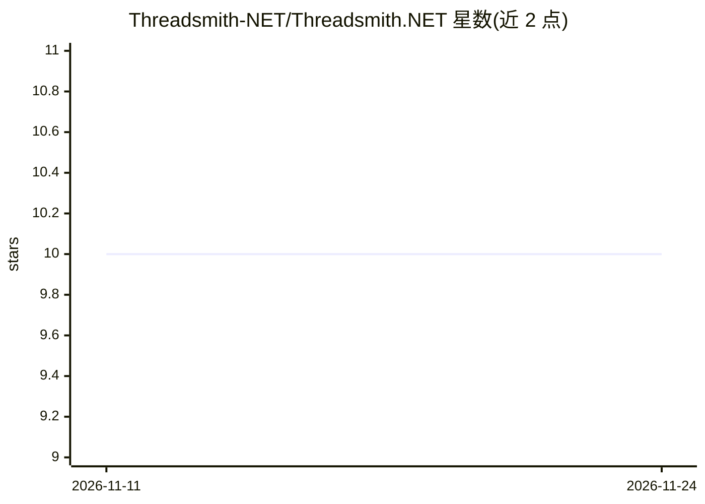

# Threadsmith-NET/Threadsmith.NET

⭐ 10 · C# · Apache-2.0 · 推送 2026-11-23 · [GitHub](https://github.com/Threadsmith-NET/Threadsmith.NET) · 个人维护

**面向 .NET 开发者的终端编码 agent 工具：编译器语义托管 AI 改码**

终端优先的 .NET 编码 harness：用 Roslyn 与 MSBuild 打开真实解决方案，模型读取源码并调用 edit_source 提出改动，宿主按策略授权精确 diff、事务化应用并返回编译器建议反馈。提供代码探索工具、会话恢复、并行工具/agent、声明式技能、MCP 连接，交互 TUI 与 headless 模式同一套命令。当前处于 beta 阶段，自包含发布包含 .NET 运行时，亦可源码构建（需 .NET 10 SDK）。

## 筛选速览

| 维度 | 判定 | 备注 |
|---|---|---|
| AI 角色 | `ai-native` | 本体是模型或模型工具 |
| 许可风险 | `permissive` | Apache-2.0 |
| 部署形态 | `desktop` | 安装包/桌面程序 |
| 模型依赖 | local-ok | 支持本地模型 |
| 硬件要求 | — | 无带数字的原话,不猜 |
| 安装摩擦 | `high` | 编译与系统依赖俱全 |
| 成熟度 | `idea` | |

## 能力要点

- 宿主托管：变更经精确 diff 审查、策略授权、事务化应用
- Roslyn/MSBuild 提供符号、引用、调用者与诊断上下文
- 支持远程与本地模型，含完全本地运行且无遥测
- TUI 与 headless/CI 模式保持命令与状态一致

## 适用场景

- 在不熟悉的大型 C# 解决方案中让 AI 代理做重构与多项目改动
- 在 CI 脚本中以 headless 方式执行仓库检查与代码修改
- 通过本地模型离线使用编码代理

## 场景标签

`编码 Agent` `代码审查` · 领域:编码与开发

## 证据(README 行号)

> L5: Threadsmith.NET opens real .NET repositories with Roslyn and MSBuild and runs an ordinary model conversation with go
> L22: - **Replaceable integrations** — model providers, extensions, MCP, Roslyn, and terminal libraries remain behind hos

## 星数曲线

2026-11-11 10 → 2026-11-24 10（+0）

---
*卡片 v1 · prompt 1.4 · 生成 2026-11-20 · 置信度 mid · 依据 README sha `5f45fa7569f5` · [字段定义](../../DATASET.md)*
