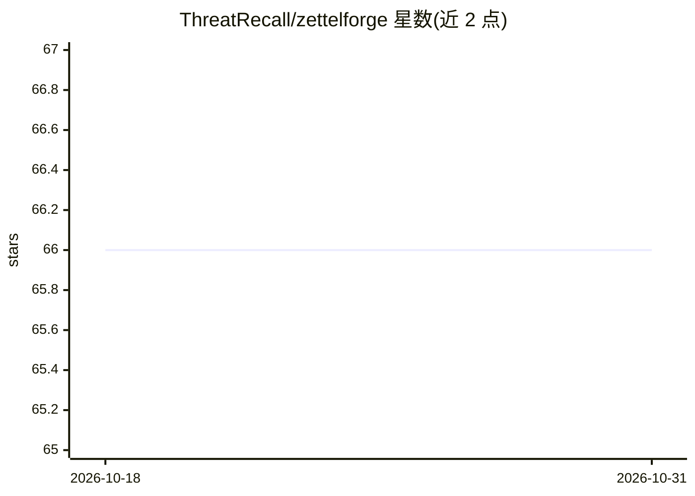

# ThreatRecall/zettelforge

⭐ 66 · Python · MIT · 推送 2026-10-29 · [GitHub](https://github.com/ThreatRecall/zettelforge) · [官网](https://docs.threatrecall.ai/) · 组织维护

**面向网络威胁情报的 Python agent 记忆系统：STIX 知识图谱+离线 RAG**

面向 CTI 分析团队的 agentic 记忆库：从分析笔记与威胁报告中抽取 CVE、威胁行为体、IOC、ATT&CK 技术，解析行为体别名，构建 STIX 2.1 知识图谱与因果三元组，检索采用向量相似度+图遍历+意图路由与交叉编码器重排。全进程内运行，fastembed(ONNX) 嵌入，可选 Ollama/llama-cpp 本地 LLM，无外部 API key，模型预载后可离线。通过 MCP server 向 Claude Code 等 agent 暴露 7 个工具；支持 Sigma/YARA 规则作为记忆原语。另有商业发行版 ThreatRecall（SaaS/私有化）。限制：无 LLM 时 synthesize 返回占位答案；zettelforge_sync 工具需企业包。

## 筛选速览

| 维度 | 判定 | 备注 |
|---|---|---|
| AI 角色 | `ai-ecosystem` | LLM/agent 周边工具 |
| 许可风险 | `permissive` | MIT |
| 部署形态 | `library` | 以包/库形式分发 |
| 模型依赖 | local-ok | 支持本地模型 |
| 硬件要求 | — | 无带数字的原话,不猜 |
| 安装摩擦 | `low` | 无编译、无系统依赖或容器化 |
| 成熟度 | — | 结构信号不足 |

## 能力要点

- 威胁实体抽取（CVE/IOC/威胁行为体/ATT&CK 技术）与别名自动解析
- STIX 2.1 知识图谱与 LLM 因果三元组推断、记忆演化（ADD/UPDATE/DELETE/NOOP）
- 全进程内、无外部 API key，模型预载后可离线运行（含物理隔离主机）
- MCP server 向 Claude Code 暴露 7 个工具；Sigma/YARA 规则可摄入为记忆

## 适用场景

- 把历年威胁情报报告和分析笔记沉淀为团队可检索的知识图谱
- 通过 Claude Code 或 LangChain agent 用自然语言调用历史情报记忆
- 批量摄入 SigmaHQ/YARA 规则库并按 ATT&CK 技术关联检索

## 场景标签

`Agent 记忆` `知识图谱` `RAG` `网络安全` · 领域:Agent 开发

## 证据(README 行号)

> L7: It extracts CVEs, threat actors, IOCs, and ATT&CK techniques from analyst notes and threat reports, resolves aliases
> L158: Seven tools are exposed: `zettelforge_remember`, `zettelforge_recall`, `zettelforge_synthesize`, `zettelforge_enti
> L65: **In-process by architecture** -- fastembed (ONNX) for embeddings, llama-cpp-python for optional local LLM inferenc

## 星数曲线

2026-10-18 66 → 2026-10-31 66（+0）

---
*卡片 v1 · prompt 1.4 · 生成 2026-10-24 · 置信度 high · 依据 README sha `e2a3c44aefa5` · [字段定义](../../DATASET.md)*
