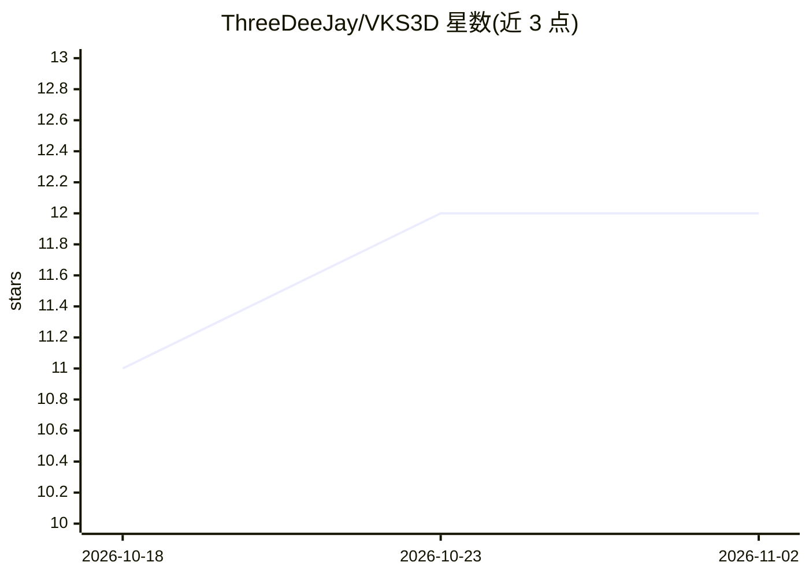

# ThreeDeeJay/VKS3D

⭐ 12 · C · GPL-3.0 · 推送 2026-11-01 · [GitHub](https://github.com/ThreeDeeJay/VKS3D) · [官网](https://airtable.com/appByPZJsOQSVGDID/shrAfMuGs1IOIEpRT?gtyDn=b%3AWzAsWyI3T05lYiIsNixbInNlbDNidUxBR0w1SHhiQXZ1Il0sImdGWUgwIl1d&uMgeK=recMg6WtuLtg9MUbS) · 个人维护

**给立体显示用户的 Vulkan 3D 驱动：任意 Vulkan 应用免改源码输出左右格式立体画面**

Windows/Linux 下的 Vulkan 1.1 ICD 层驱动，位于 Vulkan Loader 与真实 GPU 驱动之间，透明地为任意 Vulkan 应用注入左右（SBS）立体渲染：启用 multiview、加倍交换链宽度、在着色器加载时修补 SPIR-V 施加每眼视差偏移，并在提交时合成左右半幅画面。通过环境变量调节瞳距、汇聚等参数，提供预编译 zip 与源码构建（VS2022/CMake）两种安装方式。作者声明代码由人类监督的 AI 辅助完成，但产品本体为图形驱动。限制：动态渲染路径未拦截、SPIR-V 修补器为最简实现、合成目前同步等待 fence。

## 筛选速览

| 维度 | 判定 | 备注 |
|---|---|---|
| AI 角色 | `ai-enhanced` | 去掉 AI 部分产品仍成立 |
| 许可风险 | `viral` | GPL-3.0 |
| 部署形态 | `desktop` | 安装包/桌面程序 |
| 模型依赖 | — | README 未给出锁定关系 |
| 硬件要求 | — | 无带数字的原话,不猜 |
| 安装摩擦 | `medium` | 含编译或系统依赖之一 |
| 成熟度 | — | 结构信号不足 |

## 能力要点

- 无源码改动、任意 Vulkan 应用自动获得 SBS 立体渲染
- SPIR-V 顶点着色器修补实现透视正确的每眼偏移
- 全部配置走环境变量，STEREO_ENABLED=0 即纯透传零开销
- 支持 64/32 位应用与 NVIDIA/AMD/Intel GPU 驱动

## 适用场景

- 在 3D 显示器或投影上以立体 3D 游玩仅支持 Vulkan 的游戏
- 交叉眼/平行眼自由视角查看 SBS 画面（可翻转左右眼）
- 无需修改游戏文件即可开关与微调立体效果

## 场景标签

 · 领域:图形/显示驱动

## 证据(README 行号)

> L5: A **Vulkan 1.1 Installable Client Driver (ICD)** that transparently injects
> L6: Side-By-Side (SBS) stereoscopic 3D rendering into **any Vulkan application**

## 星数曲线

2026-10-18 11 → 2026-11-02 12（+1）

---
*卡片 v1 · prompt 1.4 · 生成 2026-11-01 · 置信度 low · 依据 README sha `0b19a7dc6465` · [字段定义](../../DATASET.md)*
