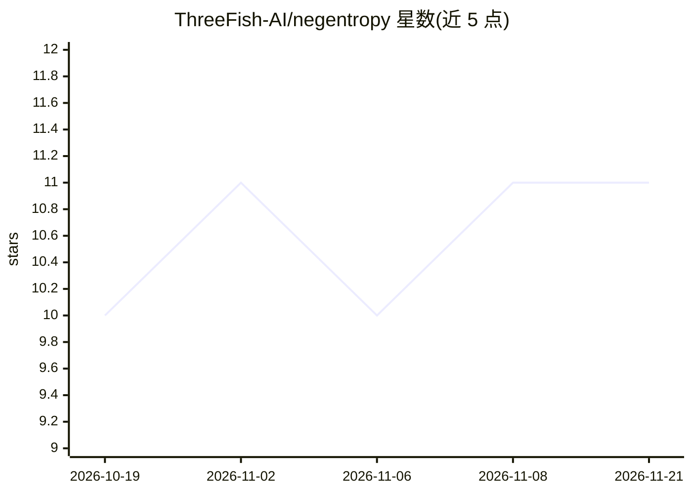

# ThreeFish-AI/negentropy

⭐ 11 · HTML · Apache-2.0 · 推送 2026-11-15 · [GitHub](https://github.com/ThreeFish-AI/negentropy) · [官网](https://threefish.site) · 组织维护 · 中文 README

**面向开发者的多智能体认知框架：一体五翼架构对抗信息熵增**

基于 Google ADK 构建的智能体系统，由 NegentropyEngine 根智能体（仅调度）通过 transfer_to_agent 将意图分发给五个正交职能体（感知、内化、深思、行动、影响），分别对应信息过载、失忆、浅层、空谈与晦涩五类失败模式。提供知识获取、问题求解、价值交付三条预置流水线，配备艾宾浩斯遗忘曲线式记忆衰减机制、知识图谱管理、MCP+MicroSandbox 沙箱代码执行，以及 OpenTelemetry/Langfuse 全链路可观测。需 Docker 或 Python 3.13/uv/Node 原生路径启动，LLM 对话需提供 OpenAI/Anthropic/Gemini 之一 API key，或通过 Ollama 本地模型实现零 key 运行。

## 筛选速览

| 维度 | 判定 | 备注 |
|---|---|---|
| AI 角色 | `ai-ecosystem` | LLM/agent 周边工具 |
| 许可风险 | `permissive` | Apache-2.0 |
| 部署形态 | `None` |  |
| 模型依赖 | local-ok | 支持本地模型 |
| 硬件要求 | — | 无带数字的原话,不猜 |
| 安装摩擦 | `low` | 无编译、无系统依赖或容器化 |
| 成熟度 | — | 结构信号不足 |

## 能力要点

- “一体五翼”编排：根智能体调度 + 五个正交职能体
- 基于艾宾浩斯遗忘曲线的动态记忆衰减与治理
- MCP 协议 + MicroSandbox 双通道沙箱代码执行
- 会话/记忆/凭证后端可在内存/PostgreSQL/VertexAI/GCS 间零代码切换

## 适用场景

- 构建需要长期记忆与知识管理的 LLM 智能体系统
- 对多智能体协作流水线进行开箱即用的编排
- 需要沙箱环境下执行代码的智能体工作流
- 通过 Langfuse/OpenTelemetry 追踪智能体决策链路

## 场景标签

`多智能体` `Agent 记忆` `知识图谱` `Agent 框架` · 领域:Agent 开发

## 证据(README 行号)

> L29:  One Root, Five Wings: the NegentropyEngine root agent (The Self · Scheduling Core, orchestration only) dispatches 
> L137: |⚙️ **Engine**|`Backend API` · ADK Web Server · FastAPI · `:3292` `NegentropyEngine` · root agent (The Self), orch

## 星数曲线

2026-10-19 10 → 2026-11-21 11（+1）

---
*卡片 v1 · prompt 1.4 · 生成 2026-11-18 · 置信度 high · 依据 README sha `0a621006497c` · [字段定义](../../DATASET.md)*
