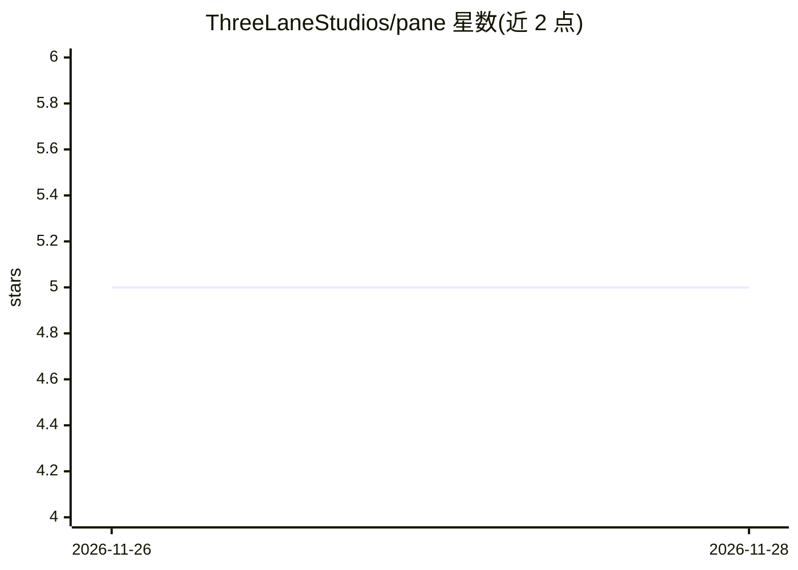

# ThreeLaneStudios/pane

⭐ 5 · Rust · Apache-2.0 · 推送 2026-11-27 · [GitHub](https://github.com/ThreeLaneStudios/pane) · [官网](https://paneapp.ai/) · 个人维护

**本地优先的开源桌面工作区：运行自有的 AI agents**

开源桌面应用，将笔记、表格、任务板、定时任务与聊天放在本机同一文件夹内，用户构建的自定义 agents 可读取并写入这些内容。关键机制：Captain & Crew 多 agent 会话调度、markdown 记忆系统（SQLite 为源）、smart routing/记忆抽取/搜索重排序三项后台模型任务、按功能切换模型提供方、密钥存入系统钥匙串。无账号无服务器，数据本地保存；提供 macOS/Linux 安装包，可从源码构建；可接入已有 OpenClaw agent 作为 provider。Windows 尚未支持。

## 筛选速览

| 维度 | 判定 | 备注 |
|---|---|---|
| AI 角色 | `ai-native` | 本体是模型或模型工具 |
| 许可风险 | `permissive` | Apache-2.0 |
| 部署形态 | `desktop` | 安装包/桌面程序 |
| 模型依赖 | local-ok | 支持本地模型 |
| 硬件要求 | — | 无带数字的原话,不猜 |
| 安装摩擦 | `low` | 无编译、无系统依赖或容器化 |
| 成熟度 | — | 结构信号不足 |

## 能力要点

- Captain & Crew：任意 agent 可任队长，成员并行运行各自会话
- Markdown 记忆系统：agent/项目/每日日志三层文件，SQLite 为源可编辑删除
- Smart routing 由小模型先判读，简单消息不经主模型
- 自带 provider：Venice/Ollama/Anthropic/OpenRouter/OpenClaw，按功能分别指定

## 适用场景

- 在本机用多个自建 agent 协作处理笔记、表格与项目任务
- 通过 cron 或事件触发的 jobs 让 agent 定时产出简报
- 配合本地 Ollama 让对话与记忆全程不出本机
- 为已有 OpenClaw agent 提供带文档/任务板的图形工作区

## 场景标签

`多智能体` `知识库管理` `AI 助手` · 领域:Agent 开发

## 证据(README 行号)

> L7: Pane is an open-source desktop app where you and your AI agents work in the same place. Build agents from scratch (a
> L9: You write notes, keep sheets, and organize projects and tasks. Your agents read all of it and, when you let them, wr
> L66: Venice, Ollama, Anthropic, OpenRouter, or OpenClaw. Switch per feature: chat, smart features, semantic search, and 

## 星数曲线

2026-11-26 5 → 2026-11-28 5（+0）

---
*卡片 v1 · prompt 1.4 · 生成 2026-11-26 · 置信度 mid · 依据 README sha `ef994139d1a9` · [字段定义](../../DATASET.md)*
