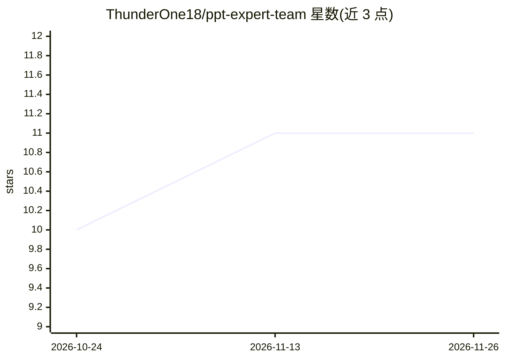

# ThunderOne18/ppt-expert-team

⭐ 11 · CSS · NOASSERTION · 推送 2026-07-11 · [GitHub](https://github.com/ThunderOne18/ppt-expert-team) · 个人维护 · 中文 README

**面向内容创作者的八步流程 PPT 生成 Claude/Codex 技能**

一个安装到 Claude/Codex 技能目录的 skill（SKILL.md 加配套资源）：输入文章、口播稿或课件，按目标→结构→视觉→拆页→逐页制作→整合→质检→回改的八步流程产出 PPT，流程中在大纲与视觉风格两处暂停等待用户确认。输出形态包括自带浏览器编辑器的单文件 HTML、PNG 图片版与文字为真文本框的可编辑 PPTX。内置六套原创风格、底图气质选择器与 12 套免费可商用字体（仓库约 39M，其中字体 31M）；底图生图依赖用户环境中已有的生图能力。

## 筛选速览

| 维度 | 判定 | 备注 |
|---|---|---|
| AI 角色 | `ai-native` | 本体是模型或模型工具 |
| 许可风险 | `none` | NOASSERTION |
| 部署形态 | `library` | 以包/库形式分发 |
| 模型依赖 | locked-api |  |
| 硬件要求 | — | 无带数字的原话,不猜 |
| 安装摩擦 | `low` | 无编译、无系统依赖或容器化 |
| 成熟度 | — | 结构信号不足 |

## 能力要点

- 八步工作流生成 PPT，大纲与视觉风格两处暂停由用户拍板
- 产出可编辑 HTML（内置编辑器）、PNG 图片版、真文本框 PPTX 三种形态
- 六套原创风格与底图气质可组合，风格选择器为本地零依赖网页
- 12 套免费可商用字体内置，离线可用

## 适用场景

- 把文章或口播稿转成能讲的 PPT
- 路演、课程、内部分享需要可继续修改的演示文稿
- 甲方要求交付可二次编辑的 .pptx 文件
- 为已有 HTML PPT 补装编辑层或导出 PPTX

## 场景标签

`AI 写作` · 领域:内容生成

## 证据(README 行号)

> L5: 一个 Claude / Codex 技能：从一篇文章、一段口播稿、一份课程内容开始，做出一套有风格、有逻辑、还能继续改的 PPT。
> L19: 所以我把自己做 PPT 的整套流程，拆成八步，写成了这个技能。它不替你拍板，它帮你把每一步做扎实。你不用每一步都自己做，你只要负责其中一两处关键判断，它负责干活。
> L41: |**可编辑 HTML PPT**（默认）|单文件网页，浏览器直接放映，自带一层编辑器——字号、位置、配色、文案你自己随手调|路演、课程、直播、内部分享|首版 20–40 分钟（含两次你拍板的环节）|

## 星数曲线

2026-10-24 10 → 2026-11-26 11（+1）

---
*卡片 v1 · prompt 1.4 · 生成 2026-11-18 · 置信度 high · 依据 README sha `eec5bdc8f35d` · [字段定义](../../DATASET.md)*
