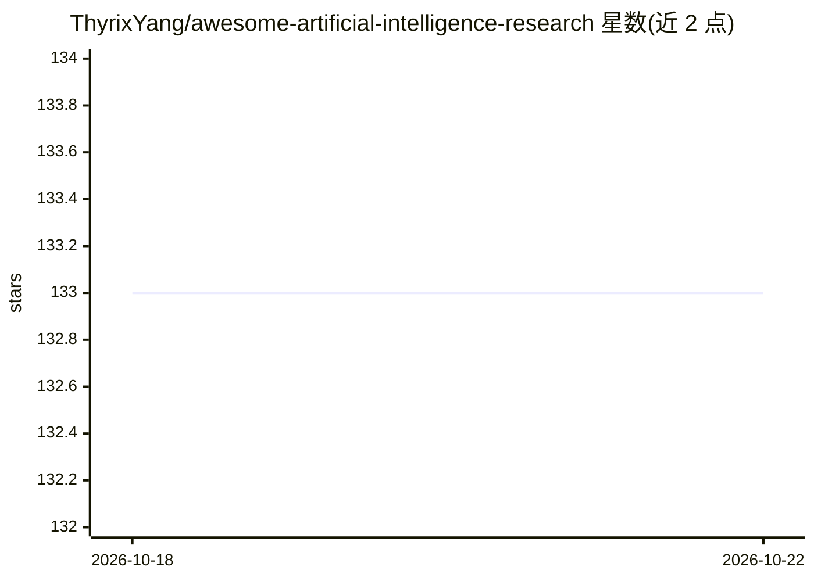

# ThyrixYang/awesome-artificial-intelligence-research

⭐ 133 · 推送 2026-10-12 · [GitHub](https://github.com/ThyrixYang/awesome-artificial-intelligence-research) · 个人维护

**AI 研究资源元清单：聚合论文清单、基准与学习资源**

策展型元清单（meta-list），将其他 awesome 清单、综述、基准数据集、模型枢纽与学习资源按主题组织收录，覆盖大语言模型、推理与后训练、RAG、AI Agent 与 MCP、安全对齐、多模态、扩散模型、计算机视觉、具身智能、核心机器学习方法、数据为中心 AI、强化学习、联邦学习与图学习等类别。条目附一句话说明，面向科研人员与初学者，用于按领域查找高信号研究资源。仅提供清单内容，无安装或运行组件。

## 筛选速览

| 维度 | 判定 | 备注 |
|---|---|---|
| AI 角色 | `ai-knowledge` | 知识聚合/清单类 |
| 许可风险 | `none` | — |
| 部署形态 | `None` |  |
| 模型依赖 | — | README 未给出锁定关系 |
| 硬件要求 | — | 无带数字的原话,不猜 |
| 安装摩擦 | `low` | 无编译、无系统依赖或容器化 |
| 成熟度 | — | 结构信号不足 |

## 能力要点

- 聚合多个领域的 AI 研究论文清单与综述
- 按 LLM/Agent/多模态/CV/具身智能/核心 ML 等类别组织
- 收录基准数据集与评测资源（RULER、MMMU、MathVista 等）
- 每条目附一句话说明其覆盖范围

## 适用场景

- 按研究方向快速定位论文清单与综述
- 查找特定领域的评测基准与数据集
- 初学者按类别浏览 AI 研究入门资源

## 场景标签

`精选清单` `科研工具` · 领域:学习与行业

## 证据(README 行号)

> L3: A curated meta-list of AI research paper lists, surveys, benchmarks, model hubs, and learning resources. It prioriti
> L5: ## Contents

## 星数曲线

2026-10-18 133 → 2026-10-22 133（+0）

---
*卡片 v1 · prompt 1.4 · 生成 2026-10-22 · 置信度 high · 依据 README sha `db39817a4130` · [字段定义](../../DATASET.md)*
