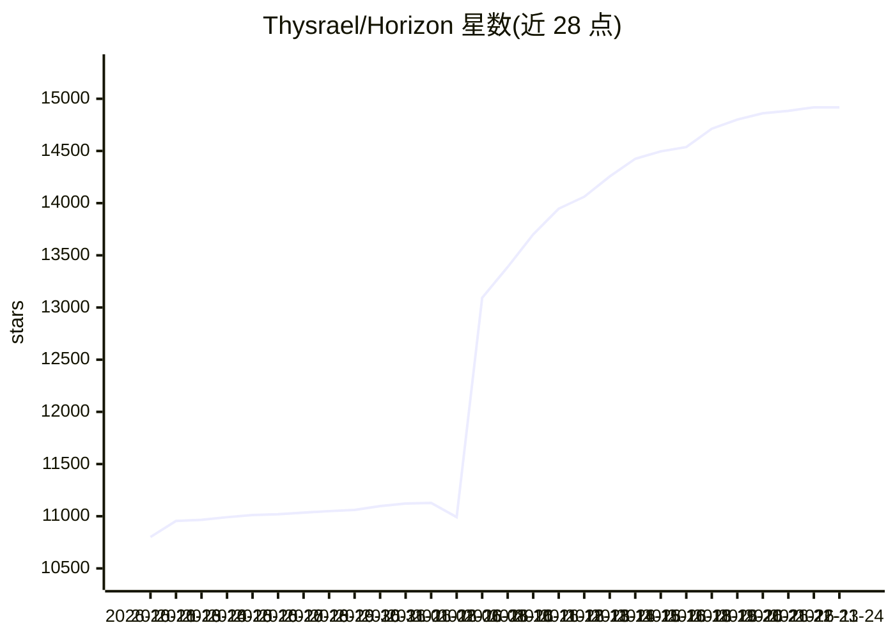

# Thysrael/Horizon

⭐ 15,055 · Python · MIT · 推送 2026-11-24 · [GitHub](https://github.com/Thysrael/Horizon) · [官网](https://www.horizon1123.top) · 个人维护 · 中文 README

**面向个人用户的 AI 新闻聚合雷达，生成中英文每日简报**

聚合 RSS、Hacker News、Reddit、Telegram、X、GitHub、金融新闻等十类信息源，通过可配置的 profile（编辑规则集）对条目打分、过滤、去重，再由 LLM 生成摘要、背景与研究讨论，产出按 profile 分组的每日简报，支持中英文。输出可发布到 GitHub Pages，或经邮件（SMTP/IMAP）、飞书/钉钉/Slack/Discord webhook、微信 iLink Bot 投递。CLI 运行全流程，AI 助手可通过 MCP Server 调用各阶段，也可经 Agent Skill 安装配置。支持 GitHub Actions 定时执行。

## 筛选速览

| 维度 | 判定 | 备注 |
|---|---|---|
| AI 角色 | `ai-native` | 本体是模型或模型工具 |
| 许可风险 | `permissive` | MIT |
| 部署形态 | `self-host` | docker 或自建部署 |
| 模型依赖 | — | README 未给出锁定关系 |
| 硬件要求 | — | 无带数字的原话,不猜 |
| 安装摩擦 | `low` | 无编译、无系统依赖或容器化 |
| 成熟度 | — | 结构信号不足 |

## 能力要点

- profile 机制：为不同内容类型定义打分标准与输出方式
- 十类信息源聚合与 profile 内去重、阈值过滤
- 多渠道投递：Pages、邮件、webhook、微信
- MCP Server 与 Agent Skill 供 AI 助手配置和调用

## 适用场景

- 每天自动收到一份按我兴趣筛选的中英文科技简报
- 把工程博客、AI 资讯等不同来源分别定制摘要角度
- 用 GitHub Actions 定时跑，简报推到飞书或邮箱

## 场景标签

`网页抓取` `工作流自动化` · 领域:效率与自动化

## 证据(README 行号)

> L26: 📡 Your own AI-powered news radar. Generates daily briefings in English & Chinese. | 构建你专属的 AI 新闻雷达
> L61: - **🎯 Decide What's Worth Reading** — Define scoring rubrics with profiles, set individual thresholds, and merge re
> L85: **Profiles define the treatment; runtime settings reflect your reading preferences.** Each item routes to one profi

## 星数曲线

2026-10-21 10,801 → 2026-11-24 14,918（+4,117）

---
*卡片 v1 · prompt 1.4 · 生成 2026-11-22 · 置信度 mid · 依据 README sha `70a14271db5c` · [字段定义](../../DATASET.md)*
