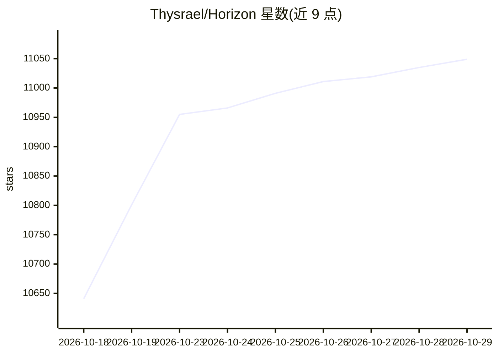

# Thysrael/Horizon

⭐ 11,049 · Python · MIT · 推送 2026-10-28 · [GitHub](https://github.com/Thysrael/Horizon) · [官网](https://www.horizon1123.top) · 个人维护 · 中文 README

**AI 驱动的个人新闻雷达：多源聚合并生成中英日报**

面向个人读者的新闻聚合与分析工具：从 RSS、Hacker News、Reddit、Telegram、X、GitHub、金融新闻等十类来源抓取内容，经 profile 定义评分规则筛选、去重，再用 LLM 生成摘要、背景与社区讨论，产出中英双语日报。简报可发布到 GitHub Pages，或经邮件、Webhook（飞书/钉钉/Slack/Discord）、微信推送。支持多模型提供商（含本地 Ollama），提供交互式配置向导、CLI 与 MCP Server，可本地 uv 安装或 Docker 部署，包尚未发布 PyPI。

## 筛选速览

| 维度 | 判定 | 备注 |
|---|---|---|
| AI 角色 | `ai-native` | 本体是模型或模型工具 |
| 许可风险 | `permissive` | MIT |
| 部署形态 | `self-host` | docker 或自建部署 |
| 模型依赖 | local-ok | 支持本地模型 |
| 硬件要求 | — | 无带数字的原话,不猜 |
| 安装摩擦 | `low` | 无编译、无系统依赖或容器化 |
| 成熟度 | — | 结构信号不足 |

## 能力要点

- 十类来源聚合（RSS/HN/Reddit/Telegram/X/GitHub/OpenBB 等）
- profile 驱动的评分、去重与差异化内容处理
- 中英双语简报，发布到 Pages 或邮件/Webhook/微信推送
- 多提供商支持（OpenAI/Gemini/Claude/DeepSeek/Ollama 等）与 MCP Server

## 适用场景

- 每天自动收到按自己口味筛选的中英科技新闻简报
- 让不同类型内容（新闻/技术长文/创作素材）各有侧重地被总结
- 把日报发布成 GitHub Pages 站点或推送到飞书、微信

## 场景标签

`AI 写作` · 领域:内容生成

## 证据(README 行号)

> L26: 📡 Your own AI-powered news radar. Generates daily briefings in English & Chinese. | 构建你专属的 AI 新闻雷达
> L62: - **🧩 Give Every Read the Right Treatment** — Choose summaries, context, solutions, or takeaways with Markdown prom
> L251: For delivery setup, see the Configuration Guide. To run pipeline stages from an AI assistant, use the **MCP Server

## 星数曲线

2026-10-18 10,641 → 2026-10-29 11,049（+408）

---
*卡片 v1 · prompt 1.4 · 生成 2026-10-20 · 置信度 mid · 依据 README sha `5bdbc6cffe92` · [字段定义](../../DATASET.md)*
