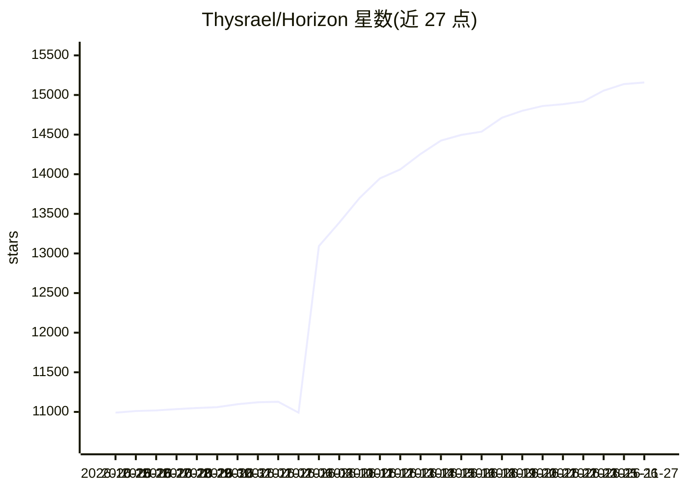

# Thysrael/Horizon

⭐ 15,158 · Python · MIT · 推送 2026-11-26 · [GitHub](https://github.com/Thysrael/Horizon) · [官网](https://www.horizon1123.top) · 个人维护 · 中文 README

**面向个人读者的 AI 新闻雷达，生成中英日报**

聚合 RSS、Hacker News、Reddit、Telegram、X、GitHub、金融新闻等十类信息源，通过 profile（可复用的编辑规则集）对条目评分、过滤、去重并生成中英文 Markdown 日报，可发布到 GitHub Pages 或经邮件、飞书/钉钉/Slack/Discord webhook、微信 iLink Bot 投递。支持 CLI 运行完整流水线，也提供 MCP Server 让 AI 助手调用各阶段，另有 Agent Skill 供助手自动安装配置。依赖用户自备模型 API key；Twitter 源依赖 Apify。

## 筛选速览

| 维度 | 判定 | 备注 |
|---|---|---|
| AI 角色 | `ai-native` | 本体是模型或模型工具 |
| 许可风险 | `permissive` | MIT |
| 部署形态 | `self-host` | docker 或自建部署 |
| 模型依赖 | — | README 未给出锁定关系 |
| 硬件要求 | — | 无带数字的原话,不猜 |
| 安装摩擦 | `low` | 无编译、无系统依赖或容器化 |
| 成熟度 | — | 结构信号不足 |

## 能力要点

- profile 机制：为不同内容类型定义评分标准与输出处理
- 十类信息源接入，含 Reddit/Twitter 热评抓取
- MCP Server 与 Agent Skill 支持 AI 助手配置与运行
- 多通道投递：GitHub Pages、SMTP/IMAP 邮件订阅、webhook、微信

## 适用场景

- 每天生成一份按兴趣筛选去重的中英文科技简报
- 让 AI 助手通过 MCP 帮我配置信息源并运行流水线
- 用 GitHub Actions 定时把日报发到飞书或邮箱

## 场景标签

 · 领域:信息聚合/内容生成

## 证据(README 行号)

> L26: 📡 Your own AI-powered news radar. Generates daily briefings in English & Chinese. | 构建你专属的 AI 新闻雷达
> L85: **Profiles define the treatment; runtime settings reflect your reading preferences.** Each item routes to one profi
> L87: Run the full pipeline through the CLI, or let an AI assistant call its stages through MCP.

## 星数曲线

2026-10-25 10,991 → 2026-11-27 15,158（+4,167）

---
*卡片 v1 · prompt 1.4 · 生成 2026-11-26 · 置信度 mid · 依据 README sha `c0ce66446827` · [字段定义](../../DATASET.md)*
