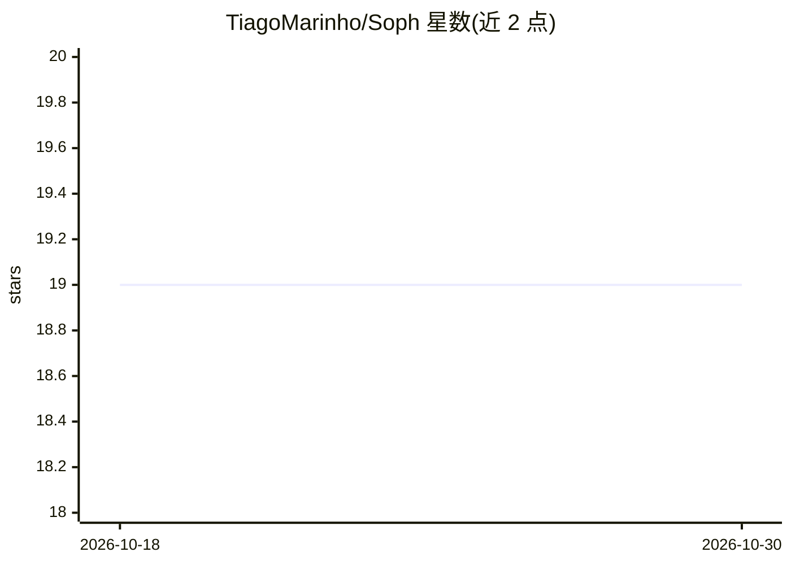

# TiagoMarinho/Soph

⭐ 19 · JavaScript · 推送 2025-12-23 · [GitHub](https://github.com/TiagoMarinho/Soph) · 个人维护

**通过 Discord 斜杠命令生成 AI 图像的机器人**

基于 discord.js 的 Discord 机器人，通过调用 Stable Diffusion WebUI API（本地、同网络或互联网均可）生成图像。提供 /dream 生图、/upscale 放大、/metadata 读取生成参数、/interrogate 反推图像标签等命令；支持 img2img、批次内提示词变体语法、负向提示/模型/采样器/步数/CFG/种子等参数调整。安装需先部署 Stable Diffusion WebUI 并加 --api 参数，再通过 git clone 获取源码、npm install 安装依赖，配置 Discord 应用 token 后以 node . 运行。

## 筛选速览

| 维度 | 判定 | 备注 |
|---|---|---|
| AI 角色 | `ai-native` | 本体是模型或模型工具 |
| 许可风险 | `none` | — |
| 部署形态 | `library` | 以包/库形式分发 |
| 模型依赖 | — | README 未给出锁定关系 |
| 硬件要求 | — | 无带数字的原话,不猜 |
| 安装摩擦 | `low` | 无编译、无系统依赖或容器化 |
| 成熟度 | — | 结构信号不足 |

## 能力要点

- 通过 Stable Diffusion WebUI API 生成图像，支持 img2img 与放大
- 可调整负向提示、模型、采样器、步数、CFG、种子等 WebUI 参数
- {prompt1 | prompt2} 语法支持批次内提示词变体
- /metadata 与 /interrogate 命令读取生成参数、反推图像标签

## 适用场景

- 在 Discord 服务器中用斜杠命令生成 AI 图像
- 对已有图像做放大、反推标签或 img2img 修改
- 在手机端通过导航按钮浏览与继续生成图片

## 场景标签

`图像生成` · 领域:内容生成

## 证据(README 行号)

> L2:  A discord bot for generating art with artificial intelligence
> L38: Soph works by communicating with Stable Diffusion WebUI API to generate images using artificial intelligence. This 

## 星数曲线

2026-10-18 19 → 2026-10-30 19（+0）

---
*卡片 v1 · prompt 1.4 · 生成 2026-10-28 · 置信度 high · 依据 README sha `a51d60540b2b` · [字段定义](../../DATASET.md)*
