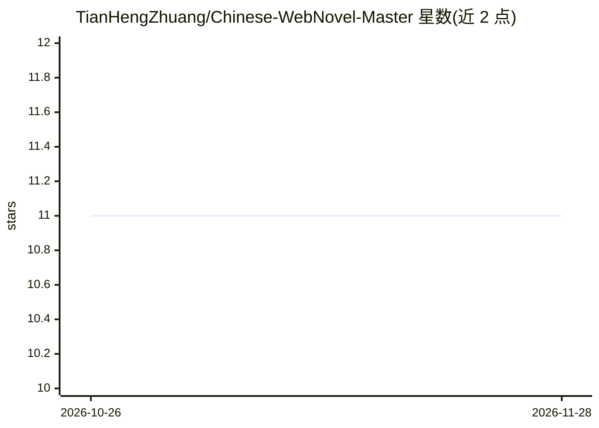

# TianHengZhuang/Chinese-WebNovel-Master

⭐ 11 · MIT · 推送 2026-11-07 · [GitHub](https://github.com/TianHengZhuang/Chinese-WebNovel-Master) · 个人维护 · 中文 README

**中文网文多智能体创作工作流：从市场分析到投稿打包**

面向中文商业网文的 Agent Skill 写作工作流，以 Markdown 知识库与流程文档构成，无代码实现。内置 Planner/Architect/Writer/Editor/Publisher 多角色分工，覆盖市场分析、世界构建、章节写作、审校与发布优化；附带 12 个中文网文平台（番茄、起点、晋江等）的读者偏好与投稿知识文件，以及 hook 生成、留存评分、标题打分、story bible 一致性台账等 16 个工具文档，并按都市系统、仙侠、末世、言情等题材提供端到端示例流程。

## 筛选速览

| 维度 | 判定 | 备注 |
|---|---|---|
| AI 角色 | `ai-knowledge` | 知识聚合/清单类 |
| 许可风险 | `permissive` | MIT |
| 部署形态 | `None` |  |
| 模型依赖 | — | README 未给出锁定关系 |
| 硬件要求 | — | 无带数字的原话,不猜 |
| 安装摩擦 | `low` | 无编译、无系统依赖或容器化 |
| 成熟度 | — | 结构信号不足 |

## 能力要点

- 五角色多智能体分工：Planner/Architect/Writer/Editor/Publisher
- 12 个中文网文平台的模式分析与投稿知识库
- 16 个创作工具文档（留存评分、标题打分、一致性检查等）
- 四个题材的完整端到端示例工作流

## 适用场景

- 在网文平台连载前做市场与题材选型分析
- 生成并审校章节，维护跨章节设定一致性
- 按目标平台准备标题、简介、标签等投稿物料

## 场景标签

`多智能体` `提示工程` `AI 写作` · 领域:Agent 开发

## 证据(README 行号)

> L48: 1. Start with SKILL.md, the entry point for the workflow.
> L113: ## Knowledge Base
> L18: The project uses a multi-agent architecture and an integrated knowledge base built from successful Chinese web fict

## 星数曲线

2026-10-26 11 → 2026-11-28 11（+0）

---
*卡片 v1 · prompt 1.4 · 生成 2026-11-18 · 置信度 mid · 依据 README sha `0d1ff6728014` · [字段定义](../../DATASET.md)*
